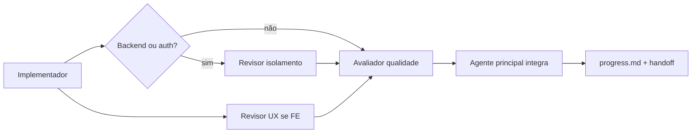

# Papéis de agente para desenvolvimento Nexo

Definições **portáveis** para orquestrar trabalho no repositório com Cursor, Claude ou Codex.
Estes papéis **não** são os nós LangGraph descritos em [arquitetura.md](arquitetura.md) (Catálogo, Roteador, etc.).
Ferramentas de desenvolvimento atendem **engenharia**; agentes do produto atendem **usuários finais**.

Skills correspondentes (gatilhos e checklists): `.cursor/skills/nexo-dev-*/SKILL.md`.

## Agente principal (integrador)

**Escopo:** Uma rodada = um ticket de [roadmap.md](roadmap.md) (ou tarefa explícita em [prompts.md](prompts.md)).

**Responsabilidades:**

1. Ler AGENTS.md, decisões, arquitetura e o ticket antes de editar.
2. Delegar papéis abaixo quando fizer sentido; **integrar** relatórios em uma conclusão única.
3. **Executar** lint, testes e typecheck/build após merges lógicos de trabalho paralelo.
4. Atualizar [progress.md](progress.md) com commit, checks e limitações.
5. **Nunca** tratar relatório de revisão como autorização de deploy, compra ou mensagem externa.

**Saída final da rodada:** arquivos alterados, evidência (comandos + resultado), limitações, próximo ticket.

## Paralelismo e conflitos de escrita

| Papel | Escrita no repo | Pode rodar em paralelo com |
|-------|-----------------|----------------------------|
| Implementador | Sim (escopo do ticket) | Revisores **somente leitura** em árvores disjuntas |
| Revisor de isolamento | Testes/fixtures de tenant em `backend/tests/` | Implementador se **não** tocar os mesmos módulos; preferir após diff estável |
| Avaliador de qualidade | `evals/`, relatórios em `docs/` | Implementador em backend enquanto QA roda subset em CI local; evitar editar os mesmos arquivos |
| Revisor de UX | Relatório (markdown em thread ou `docs/` se autorizado) | Implementador backend; conflita com FE-00x no mesmo componente |

**Regra:** duas tarefas que alteram o **mesmo arquivo** não rodam em paralelo. Revisão **não** substitui testes do integrador.

## Papéis

### 1. Implementador do ticket

| Campo | Conteúdo |
|-------|----------|
| **Escopo** | Implementar **apenas** o ticket indicado e dependências já concluídas no [progress.md](progress.md). Caminho vertical; sem simular integrações reais. |
| **Arquivos permitidos** | Paths listados no ticket em roadmap.md; mais testes, migrations e docs **mínimos** exigidos pelo aceite. Proibido: `.env`, secrets, dados de cliente. |
| **Formato do relatório** | Plano curto → alterações → comandos de verificação → limitações → próximo ticket. |
| **Evidências exigidas** | Diff coerente com aceite; testes novos ou estendidos; nenhuma afirmação de feature além do código. |

Skill: [nexo-dev-implementer](../.cursor/skills/nexo-dev-implementer/SKILL.md).

### 2. Revisor de isolamento

| Campo | Conteúdo |
|-------|----------|
| **Escopo** | Auditar ADR-002/003: tenant da membership, RLS, repositórios, schemas analíticos, cache frontend, checkpoints futuros. |
| **Arquivos permitidos** | Leitura: `backend/app/auth.py`, `tenancy.py`, `repositories.py`, rotas tocadas, `frontend/lib/session.ts`. Escrita: `backend/tests/test_*_pg.py`, `test_auth.py`, fixtures — **não** alterar lógica de produção sem passar pelo implementador. |
| **Formato do relatório** | Resumo pass/fail por eixo; achados com severidade; comandos pytest; patches sugeridos (opcional). |
| **Evidências exigidas** | Matriz recurso × filtro de tenant; teste de acesso cruzado reproduzível ou citação a teste existente. |

Skill: [nexo-dev-isolation-reviewer](../.cursor/skills/nexo-dev-isolation-reviewer/SKILL.md). Checklist profundo: [nexo-tenant-review](../.cursor/skills/nexo-tenant-review/SKILL.md).

### 3. Avaliador de qualidade

| Campo | Conteúdo |
|-------|----------|
| **Escopo** | Verificar regressão: lint, pytest, typecheck/build, e quando aplicável harness de eval (BE-011+) com fixtures sintéticas. |
| **Arquivos permitidos** | Leitura: todo o repo. Escrita: `evals/`, artefatos de relatório em `docs/validacao.md` ou anexo citado no progress — **não** alterar código de feature salvo correção trivial acordada com implementador. |
| **Formato do relatório** | Tabela check × status × comando; falhas com trecho de log; métricas de eval quando existir harness. |
| **Evidências exigidas** | Saída literal de `ruff`, `pytest`, `npm run typecheck` / `build`; para gate, métricas definidas em roadmap (acurácia, cobertura, erro confiante, custo, p95). |

Skill: [nexo-dev-quality](../.cursor/skills/nexo-dev-quality/SKILL.md). Eval analítico: [nexo-eval](../.cursor/skills/nexo-eval/SKILL.md).

### 4. Revisor de UX

| Campo | Conteúdo |
|-------|----------|
| **Escopo** | Fluxos FE vs [flows.md](flows.md) e critérios do ticket; estados vazios/erro; acessibilidade básica; copy alinhada a `needs_setup` / limites reais do produto. |
| **Arquivos permitidos** | Leitura: `frontend/app/**`, componentes compartilhados, contratos em [api.md](api.md). Escrita: relatório apenas — mudanças visuais ficam com implementador FE. |
| **Formato do relatório** | Fluxo × tela × problema (bloqueante/melhoria); screenshot ou descrição reproduzível; sugestão concreta sem inventar dados. |
| **Evidências exigidas** | Lista de rotas exercidas; discrepância API ↔ UI; confirmação de que troca de org invalida cache quando relevante. |

Skill: [nexo-dev-ux](../.cursor/skills/nexo-dev-ux/SKILL.md).

## Sequência sugerida por ticket

## Limites globais (todos os papéis)

- Sem deploy, SSH em VPS, compras, contas externas ou mensagens a clientes sem autorização humana.
- Sem dados de produção em prompts, evals ou logs.
- Sem chaves em Git, frontend ou skills.
- Revisão aprovada **≠** go-live; use [nexo-release](../.cursor/skills/nexo-release/SKILL.md) antes de staging/piloto.
