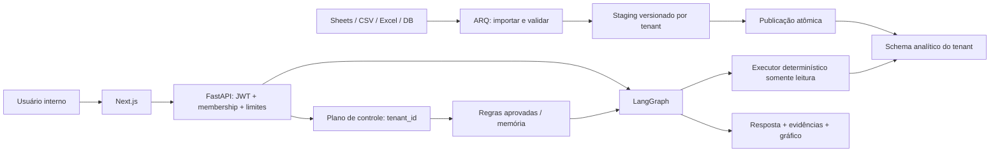
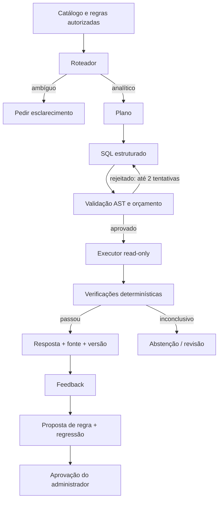

# Arquitetura do produto e dos agentes

## Caminho de dados

## Agentes com responsabilidade delimitada

Não iniciar dezenas de agentes chamando modelos simultaneamente. Separar papéis e medir
quais precisam de LLM. Autorização, normalização e execução devem ser código determinístico.

| Nó | Entrada | Saída contratada | Falha / limite |
|---|---|---|---|
| Catálogo | IDs autorizados, schema_version | tabelas/colunas permitidas, tipos, amostras mascaradas | fonte não pronta → needs_setup |
| Perfilador de ingestão | staging, estatísticas | tipos sugeridos, problemas, chaves candidatas | nunca publica inferência silenciosa |
| Entrevistador semântico | ambiguidades + catálogo | perguntas ao dono e propostas de métricas | exige aprovação, não adivinha regras |
| Roteador | pergunta + regras + contexto | clarify / analytic / unsupported | até uma pergunta de esclarecimento por rodada |
| Planejador analítico | intenção estruturada | métricas, dimensões, filtros, período e timezone | fonte/regras ambíguas → clarify |
| Gerador SQL | plano + catálogo aprovado | SQL e parâmetros, sem execução | duas tentativas no máximo |
| Validador | AST + catálogo + orçamento | approved / rejected com motivo | nenhum LLM autoriza sua própria consulta |
| Executor | SQL validado + role tenant | linhas limitadas + query_id + duração | timeout e transação read-only |
| Verificador | plano, resultado, checagens | answerable / partial / needs_review | checks de soma/unidade/granularidade |
| Apresentador | dados já calculados | resposta + spec de gráfico allowlist | proibido recalcular números em texto |
| Curador de memória | feedback + evidências | proposta versionada + casos de regressão | aprovação humana necessária |

## Grafo desejado

O grafo implementado nesta entrega contém apenas `catalog → clarify`, sem chamadas de modelo.
O fluxo desejado acima é detalhado pelos tickets BE-006 a BE-011.

## Estado e contratos

Estado deve conter `tenant_id` derivado do acesso, `user_id`, `request_id`, `conversation_id`,
`source_ids`, `schema_version`, `semantic_version`, timezone, pergunta, plano, SQL,
parâmetros, tentativas, `query_run_id`, linhas, token_usage, custo estimado e estado final.
JSONs do modelo devem usar schemas Pydantic com `extra=forbid`. Persistir checkpoints
com namespace do tenant; proibir recuperar thread/checkpoint de outra organização.

Estados finais: `answered`, `partial`, `needs_clarification`, `needs_setup`, `refused`, `failed`.
Não mostrar porcentagem de confiança gerada pelo próprio modelo como garantia estatística.
Mostrar quais verificações passaram e quais limitações permanecem.

## Execução segura

1. Recuperar catálogo e tabelas autorizadas pelo tenant autenticado.
2. Rejeitar múltiplos statements, DDL/DML, SELECT INTO, locks, catálogos internos,
   funções não permitidas, relações fora da allowlist e chamadas de rede/arquivos.
3. Usar usuário analítico distinto, sem ownership, sem CREATE, sem acesso a outros schemas.
4. Abrir transação `READ ONLY`, aplicar `statement_timeout`, `lock_timeout` e `search_path`
   seguro; não depender de `search_path` para autorização. Tabelas devem ser qualificadas.
5. Limitar linhas retornadas (500), bytes, duração (5–10s inicial) e concorrência por tenant.
   LIMIT não evita varrer bilhões de linhas: validar custo de EXPLAIN, particionar e limitar período.
6. Tratar erro do banco como dado; não repassar credenciais ou stack trace ao modelo/cliente.

`sql_guard.py` implementa um subconjunto conservador de SELECT. Não está conectado a um
executor e não substitui as permissões do banco. Liberar CTE, funções e subqueries apenas
com novos testes adversariais e necessidade real.

## Memória e qualidade

Memória por tenant: regras semânticas aprovadas, exemplos de SQL validados e perguntas
de regressão. Não é treinamento dos pesos a cada mensagem. Embeddings pgvector podem
recuperar exemplos, mas não podem buscar entre tenants. Invalidar exemplos quando catálogo
ou regra muda. Correção conflitante deve gerar revisão, não sobrescrever regra em silêncio.

Gate do piloto: conjunto independente com pelo menos 60 perguntas aprovadas pelo cliente,
incluindo números, ambiguidade, períodos, devoluções, vazamento e fonte desatualizada.
Registrar acerto entre respondidas, cobertura, erro confiante, abstenção, custo e p95.
Meta inicial proposta: >=95% entre respondidas, cobertura >=80%, nenhum vazamento, nenhum
erro crítico confiante no conjunto. Isso é critério de teste finito, não promessa universal.

## WhatsApp em v2

Identidade do contato externo é diferente do usuário interno. O bot comercial recebe apenas
ferramentas públicas autorizadas: catálogo, horário e situação do próprio pedido verificada.
Nunca herda permissão do dono para consultar faturamento. Handoff humano, opt-out,
assinatura do webhook e deduplicação são obrigatórios antes de responder automaticamente.
Conversas ingeridas são conteúdo não confiável; não viram instruções ou regras por si só.
