# Fluxos do aplicativo — usuário, código, agentes e integrações

**Snapshot inspecionado em 28/10/2026.** Fonte: código da pasta aberta no Cursor,
`C:/Arthur Granito/nexo-roadmap-boilerplate/nexo`, e documentos de arquitetura/roadmap.
O nome comercial continua provisório. Este documento não modifica o comportamento do app.

## Como ler

- **Atual:** confirmado por leitura de handlers/funções. Não significa que todos os caminhos
  de erro foram executados nesta rodada de documentação.
- **Atual — só API:** endpoint existe, mas a página atual não oferece a ação.
- **Atual — função não conectada:** código existe isoladamente, sem caminho pelo chat.
- **Planejado:** comportamento alvo a implementar. Mensagens e endpoints novos são propostas
  de contrato, não evidência de recursos funcionando. Chamadas Supabase/Google/Meta/Asaas
  descrevem responsabilidades; detalhes de SDK/política devem ser verificados ao implementar.
- `tenant` é a organização/empresa. `user_id` é a identidade autenticada. Um header com
  tenant_id é só a seleção; a membership no servidor decide acesso.

O documento apresenta primeiro atores e inventário completo, depois os circuitos reais,
o desenho desejado, o detalhamento dos fluxos e a matriz de rastreabilidade.

## 1. Atores

| Ator | Responsabilidade e fronteira |
|---|---|
| Visitante / novo usuário | Cadastro, confirmação e recuperação; ainda sem dados de empresa |
| Owner | Organização, assinatura, convites e decisões sensíveis |
| Admin | Fontes, regras e membros conforme hierarquia |
| Analyst | Consultas e edição de conteúdo; granularidade final depende de BE-002 |
| Viewer | Leitura; na API atual também envia chat por access(), sem editor() |
| Responsável pelo dado | Confirma tipos, regras e qualidade; não é automaticamente um novo papel de autorização |
| Atendente humano | Assume conversa externa no tenant autorizado |
| Contato WhatsApp externo | Acesso somente a ferramentas públicas e aos próprios dados verificados |
| Frontend Next.js | Interface, sessão futura, estado local e consumo da API |
| API FastAPI | DTO, autorização, serviços, transações, limites e respostas |
| LangGraph / nós do produto | Planejamento e apresentação dentro de contexto permitido; sem conceder permissões |
| PostgreSQL / catálogo / memória | Dados versionados, regras e evidências; roles/RLS fortes ainda são gate |
| Scheduler / outbox / ARQ / Redis | Agendamento, transporte e execução idempotente de jobs |
| Supabase Auth | Identidade, e-mail de confirmação, sessão e credenciais |
| Google / DB externo | Fonte autorizada, nunca instrução confiável para o app |
| Resend | Entrega de relatórios/e-mails configurados |
| Asaas | Cobrança e estado financeiro autoritativo |
| Meta/WhatsApp | Eventos, mensagens e estados de entrega |
| Operador / CI / suporte | Deploy, diagnóstico, qualidade e recuperação com acesso mínimo |

## 2. Inventário completo antes do detalhamento

| ID | Fluxo | Estado |
|---|---|---|
| A01 | [Iniciar a aplicação e preparar o ambiente demo](#fluxo-a01) | Atual |
| A02 | [Abrir a interface e enviar uma requisição](#fluxo-a02) | Atual |
| A03 | [Autenticar e autorizar uma chamada privada](#fluxo-a03) | Atual |
| A04 | [Listar as organizações do usuário](#fluxo-a04) | Atual |
| A05 | [Carregar fontes e paginar a lista](#fluxo-a05) | Atual |
| A06 | [Cadastrar uma fonte de dados (somente metadados)](#fluxo-a06) | Atual |
| A07 | [Enviar pergunta no chat atual: circuito real completo](#fluxo-a07) | Atual |
| A08 | [Registrar uma proposta de correção](#fluxo-a08) | Atual — só API |
| A09 | [Cadastrar e listar dashboards de metadados](#fluxo-a09) | Atual — só API |
| A10 | [Validar SQL usando a função isolada existente](#fluxo-a10) | Atual — função não conectada ao chat |
| A11 | [Iniciar worker e executar heartbeat](#fluxo-a11) | Atual — capacidade interna |
| A12 | [Consultar saúde, prontidão e tratar falhas HTTP](#fluxo-a12) | Atual |
| P01 | [Cadastro de conta e criação de organização](#fluxo-p01) | Planejado |
| P02 | [Verificar e-mail e aceitar convite](#fluxo-p02) | Planejado |
| P03 | [Login e seleção de organização](#fluxo-p03) | Planejado |
| P04 | [Sessão expirada, renovação e logout](#fluxo-p04) | Planejado |
| P05 | [Recuperar e trocar senha](#fluxo-p05) | Planejado |
| P06 | [Trocar organização e concluir onboarding](#fluxo-p06) | Planejado |
| P07 | [Administrar membros, convites e papéis](#fluxo-p07) | Planejado |
| P08 | [Gerenciar o ciclo de vida de fontes](#fluxo-p08) | Planejado |
| P09 | [Upload CSV/Excel e prévia de importação](#fluxo-p09) | Planejado |
| P10 | [Normalizar, perfilar e revisar dados](#fluxo-p10) | Planejado |
| P11 | [Publicar snapshot e catálogo de forma atômica](#fluxo-p11) | Planejado |
| P12 | [Entrevistar, aprovar e manter regras semânticas](#fluxo-p12) | Planejado |
| P13 | [Conectar Google Sheets via OAuth](#fluxo-p13) | Planejado |
| P14 | [Sincronizar Sheets automaticamente ou sob demanda](#fluxo-p14) | Planejado |
| P15 | [Conectar e sincronizar Postgres/MySQL externos](#fluxo-p15) | Planejado |
| P16 | [Tratar mudança de estrutura e dados desatualizados](#fluxo-p16) | Planejado |
| P17 | [Fazer pergunta analítica: circuito completo desejado](#fluxo-p17) | Planejado |
| P18 | [Pedir esclarecimento e retomar a análise](#fluxo-p18) | Planejado |
| P19 | [Recusar pedido indevido ou fora do escopo](#fluxo-p19) | Planejado |
| P20 | [Gerar, validar e corrigir SQL com limite de tentativas](#fluxo-p20) | Planejado |
| P21 | [Executar SQL somente leitura e cancelar com segurança](#fluxo-p21) | Planejado |
| P22 | [Verificar resultado, ausência de dados e resposta parcial](#fluxo-p22) | Planejado |
| P23 | [Consultar histórico, evidências e filtrar recursos](#fluxo-p23) | Planejado |
| P24 | [Corrigir resposta e propor aprendizado](#fluxo-p24) | Planejado |
| P25 | [Aprovar, testar, versionar e reverter memória](#fluxo-p25) | Planejado |
| P26 | [Gerar gráfico e salvar dashboard pelo chat](#fluxo-p26) | Planejado |
| P27 | [Filtrar, atualizar, editar e excluir dashboards](#fluxo-p27) | Planejado |
| P28 | [Criar, pré-visualizar, pausar e excluir relatório agendado](#fluxo-p28) | Planejado |
| P29 | [Executar relatório e enviar com deduplicação](#fluxo-p29) | Planejado |
| P30 | [Escolher plano e iniciar cobrança](#fluxo-p30) | Planejado |
| P31 | [Receber webhook financeiro, falha e reconciliação](#fluxo-p31) | Planejado |
| P32 | [Cancelar plano e aplicar limites de uso](#fluxo-p32) | Planejado |
| P33 | [Conectar WhatsApp oficial e verificar webhook](#fluxo-p33) | Planejado |
| P34 | [Atender cliente externo pelo WhatsApp](#fluxo-p34) | Planejado |
| P35 | [Assumir atendimento humano e respeitar opt-out](#fluxo-p35) | Planejado |
| P36 | [Analisar conversas do WhatsApp no chat interno](#fluxo-p36) | Planejado |
| P37 | [Exportar dados e solicitar exclusão/retencão](#fluxo-p37) | Planejado |
| P38 | [Administrar auditoria e acesso de suporte](#fluxo-p38) | Planejado |
| P39 | [Retentar jobs, deduplicar eventos e recuperar worker morto](#fluxo-p39) | Planejado |
| P40 | [Avaliar qualidade e liberar uma versão](#fluxo-p40) | Planejado |
| P41 | [Deploy, migration, backup, restauração e incidentes](#fluxo-p41) | Planejado |

## 3. Cobertura revisada

| Área obrigatória | Fluxos | Situação |
|---|---|---|
| Cadastro, convite e verificação de e-mail | P01–P02 | Planejado |
| Login, logout, expiração, recuperação e troca de senha | A03; P03–P05 | Verificação de Bearer atual; telas/ciclo de sessão planejados |
| Organização, onboarding e membros | A01/A04; P06–P07 | Seed/lista atuais; administração planejada |
| CRUD das entidades principais | A05/A06/A08/A09; P08/P12/P23–P32/P37 | Ver matriz por entidade no final |
| Busca, filtros e paginação | A05/A09; P23/P27/P36/P38 | Offset/limit atuais; busca avançada planejada |
| Permissão negada e recurso inacessível | A03/A08; P19 | Testar também no banco/role antes de produção |
| Ingestão, fontes e jobs | A11; P09–P16/P39 | Worker atual tem apenas heartbeat não agendado |
| Perguntas, SQL, resposta, gráfico e aprendizado | A07/A10; P17–P27 | Grafo real ainda é catalog → clarify |
| Pagamento, falha e cancelamento | P30–P32 | Planejado, não descartado |
| Relatórios e envio externo | P28–P29 | Planejado |
| Atendimento e análise WhatsApp | P33–P36 | Planejado |
| Administração, privacidade e suporte | P07/P37/P38 | Planejado |
| Qualidade, deploy, backup e incidentes | A01/A12; P40/P41 | Infra local parcial; gates futuros |

**Considerados e fora do escopo inicial:** marketplace, app mobile nativo, SSO corporativo,
consulta federada em tempo real, fine-tuning automático por feedback e alterações de negócio
como cancelar pedido/conceder desconto por chat. Não há fluxo de execução dessas ações no
produto definido; pedido assim deve ser recusado ou encaminhado a humano. Estratégia de MFA
e SSO pode ser adicionada depois conforme exigência do cliente, sem presumir implementação.

## 4. Circuitos reais do código

### 4.1 Uma pergunta hoje

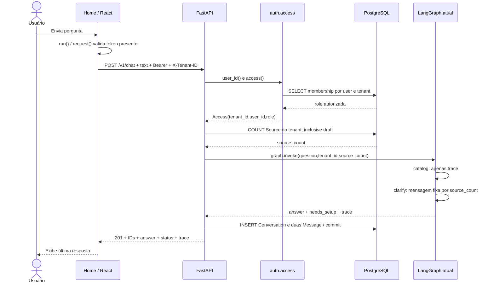

Não há seta daqui até LLM, executor, QueryRun ou ARQ: esses componentes não são chamados
pelo handler atual. `catalog` é nome de nó; sua implementação atual não carrega catálogo.

### 4.2 Autorização compartilhada

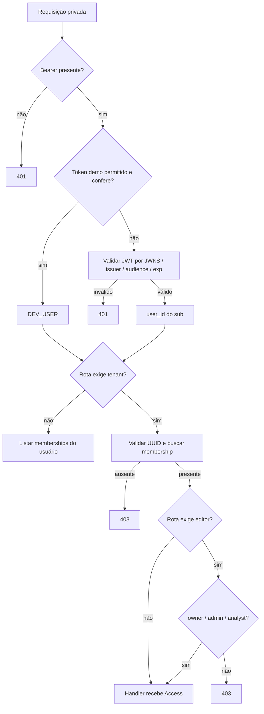

### 4.3 Cadastro de fonte hoje

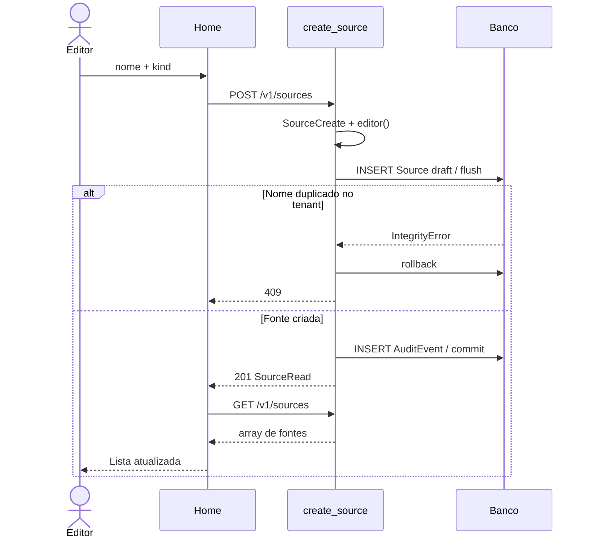

### 4.4 Mapa função → circuito atual

| Entrada | Funções e percurso | Escrita/efeito |
|---|---|---|
| Carregar fontes | Home → run → request → sources → access → select | só leitura |
| Cadastrar fonte | Home → run → request → SourceCreate → editor → create_source → audit → commit | Source + AuditEvent |
| Enviar pergunta | Home → run → request → Question → access → chat → graph.invoke → catalog → clarify → commit | Conversation + 2 Message |
| Corrigir resposta | API externa → CorrectionCreate → editor → correct → busca Message → audit → commit | Correction pending + AuditEvent |
| Criar dashboard | API externa → DashboardCreate → editor → create_dashboard → audit → commit | Dashboard metadata + AuditEvent |
| Listar dashboards | API externa → access → dashboards → select | só leitura |
| Validar SQL | teste/chamador → validate_query → sqlglot AST | retorna SQL; zero execução |
| Worker | ARQ → startup; se enfileirado → heartbeat | resultado ARQ; sem job de negócio |

## 5. Circuitos do produto completo (planejados)

### 5.1 Exemplo concreto: loja que mais vendeu no mês

Pergunta: **“Qual loja vendeu mais neste mês, descontando devoluções?”**

1. API autentica usuário e empresa, verifica quota e captura request_id.
2. Catálogo entrega apenas tabelas/colunas autorizadas e versão publicada; memória recupera
   definição aprovada de venda líquida. Se não existir, o entrevistador/esclarecimento pergunta.
3. Planejador fixa métrica `venda_liquida`, dimensão `loja`, intervalo absoluto e timezone.
   “Neste mês” não é deixado à interpretação posterior do modelo.
4. Gerador produz SQL com nomes reais descobertos no catálogo e parâmetros. Um exemplo
   didático seria agrupar por loja e somar vendas menos devoluções; o SQL exato depende do
   modelo real, que pode ter devoluções negativas ou tabela separada.
5. Validador verifica AST, catálogo, funções, limites e custo; executor usa role readonly.
6. Verificador confere regra de devolução, unidade, período e empate. Apresentador usa os
   números retornados, indica fonte/data e opcionalmente monta gráfico de barras.
7. Evidências e consumo ficam associados à execução. Nada é enviado ao WhatsApp por essa pergunta.

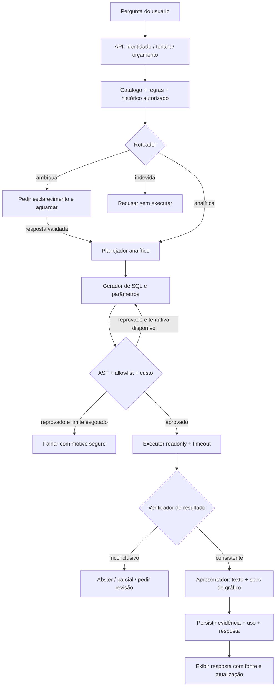

### 5.2 Os 11 papéis em três circuitos

| Papel | Circuito | Quando atua |
|---|---|---|
| Catálogo | ingestão/consulta | disponibiliza estrutura autorizada e versão |
| Perfilador | ingestão | normaliza/perfila estrutura e sugere problemas |
| Entrevistador semântico | onboarding/revisão | pergunta significados não inferíveis |
| Roteador | consulta | escolhe análise, esclarecimento ou recusa |
| Planejador | consulta | define métrica/dimensão/filtro/período |
| Gerador SQL | consulta | propõe SQL sem executar |
| Validador SQL | consulta | código determinístico autoriza ou bloqueia |
| Executor | consulta | código roda somente leitura |
| Verificador | consulta | aplica checks e determina limitações |
| Apresentador | consulta | texto/spec com valores já calculados |
| Curador de memória | correção | propõe aprendizado, testes e revisão |

São papéis de arquitetura, não obrigação de 11 modelos/processos nem grafo linear único.
As duas tentativas do gerador significam **duas gerações no total**, não duas correções
adicionais. O grafo completo precisa definir budgets e contratos no BE-007/008.

### 5.3 Ingestão e publicação

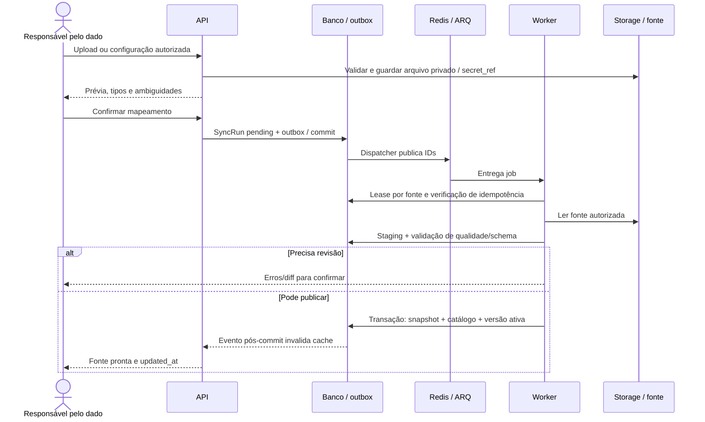

### 5.4 Sessão e autenticação futuras

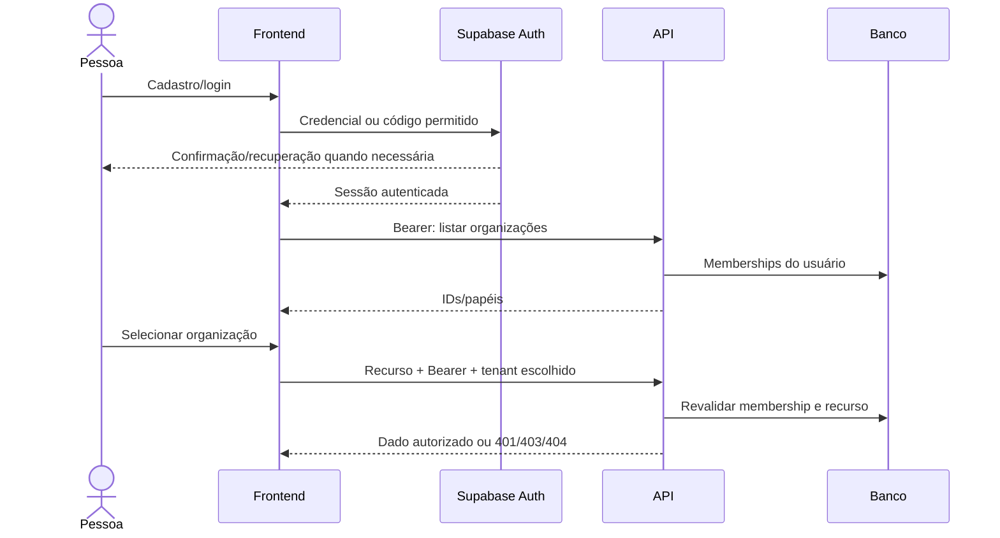

### 5.5 Aprender por correção sem contaminar regras

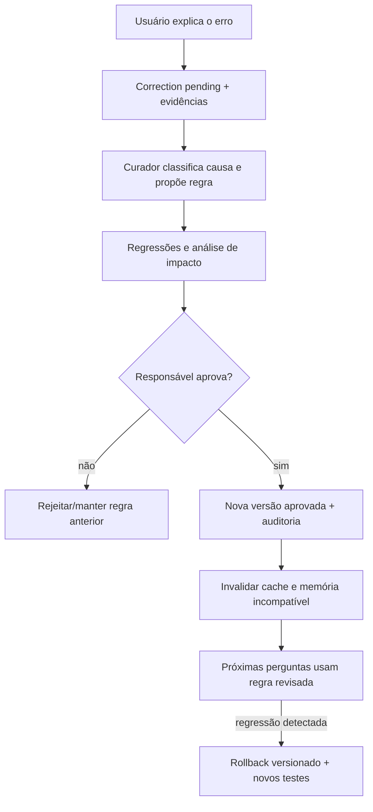

### 5.6 Sheets, polling e evento de edição

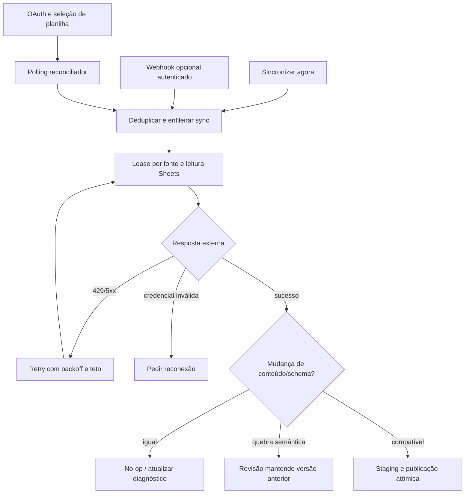

### 5.7 Relatório agendado

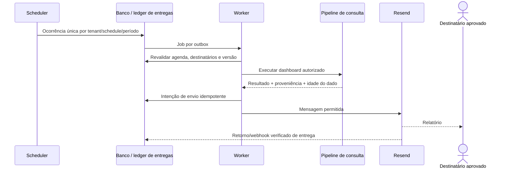

### 5.8 Cobrança e ativação

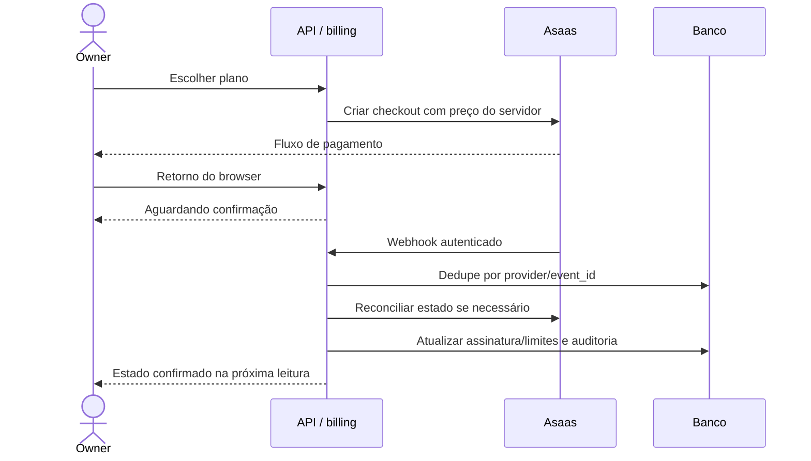

### 5.9 WhatsApp: atendimento e análise interna separados

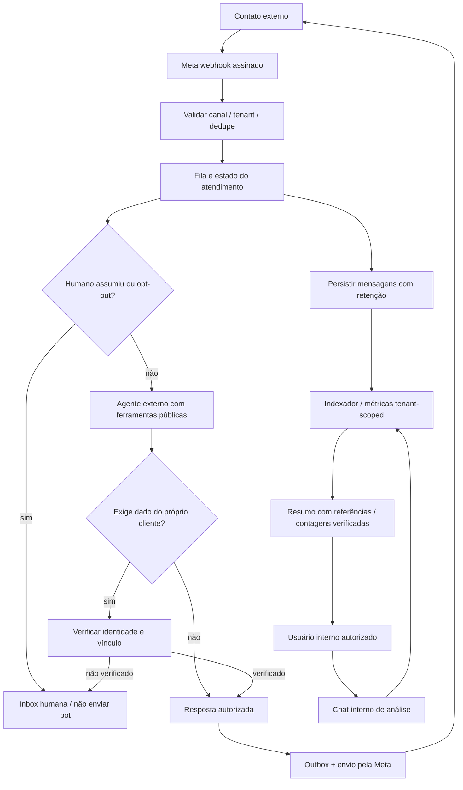

Não há seta de contato externo para o catálogo financeiro interno. O identificador do número
do WhatsApp, sozinho, não prova acesso a pedido/dado pessoal. Escritas de negócio ficam
fora do escopo inicial e precisam autorização/ferramentas próprias numa evolução futura.

### 5.10 Privacidade e recuperação

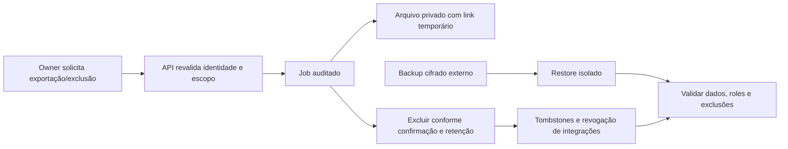

## 6. Detalhamento de cada fluxo

Em cada passo abaixo, o trecho antes de `→` descreve o gatilho/ação do ator ou componente;
depois de `→`, a resposta do sistema e os dados enviados/retornados. Jobs também são atores.
Todos os textos de erro dos fluxos Pxx são propostas de UX, exceto referência explícita a Axx.

<a id="fluxo-a01"></a>

### A01 — Iniciar a aplicação e preparar o ambiente demo

**Estado:** Atual. **Ator:** Operador / Docker Compose.

**Gatilho:** Executar docker compose up --build -d e, separadamente, o seed.

**Pré-condições:** Docker ativo, .env válido e portas 3000/8000 livres.

**Passos e dados em trânsito:**

1. Operador inicia Compose → db e redis sobem com volumes persistentes; trafegam configurações de conexão por ambiente, sem passar pelo browser.
2. db fica saudável → migrate executa alembic upgrade head e cria as tabelas e a extensão vector no PostgreSQL.
3. Migration termina → api e worker iniciam; Settings valida ENVIRONMENT/DEV_AUTH; engine SQLAlchemy é criado; build_graph() compila o grafo uma vez por importação do módulo.
4. API responde ao healthcheck /ready → web pode iniciar e publicar 127.0.0.1:3000.
5. Operador executa o perfil tools/seed → seed.main() cria Tenant demo, Membership owner, Subscription trial e Source draft se necessário; retorna ID da organização no terminal.
6. Seed encontra PostgreSQL → cria o schema demo numa segunda transação; não importa o CSV e não gera embeddings.

**Alternativos:** Seed pode ser repetido: procura organização e fonte existentes. SQLite serve ao plano de controle e pula CREATE SCHEMA.

**Erros e mensagem ao usuário:** Porta ocupada: erro do Docker, sem mensagem no app. .env inválido: API não inicia. Se CREATE SCHEMA falhar após o primeiro commit, os registros demo podem existir sem o schema; repetir após corrigir.

**Pós-condições:** Aplicação acessível, banco preparado e demo opcional cadastrada; nenhum motor analítico ativo.

**Efeitos colaterais:** Migration altera banco; seed grava dados sintéticos. Não envia e-mail, não chama IA e não agenda importação.

**Entidades:** Tenant, Membership, Subscription, Source.

**Entradas/endpoints:** `GET /ready (healthcheck)`.

**Código ou tickets:** `docker-compose.yml; app/config.py; app/seed.py; app/agents.py; migrations/versions/0001_initial.py`.

<a id="fluxo-a02"></a>

### A02 — Abrir a interface e enviar uma requisição

**Estado:** Atual. **Ator:** Usuário interno.

**Gatilho:** Abrir / e clicar numa ação da página.

**Pré-condições:** Frontend e API disponíveis.

**Passos e dados em trânsito:**

1. Usuário abre / → Home inicializa estado local com API localhost:8000, organização demo, token vazio, fontes vazias e nenhuma resposta; não faz fetch automático.
2. Usuário informa URL, organização e token → React mantém os valores em memória da página; não há login, validação de organização ou persistência de sessão nesta tela.
3. Usuário clica na ação → run() limpa error e marca busy=true; request(path, body) exige token antes de chamar a rede.
4. request() monta fetch → GET sem body ou POST com JSON; envia Authorization: Bearer, X-Tenant-ID e Content-Type; não há timeout, retry ou AbortController explícito.
5. API devolve JSON → request() chama response.json(); resposta não-2xx vira Error com error.detail se string; a ação atualiza seu estado de sucesso.
6. run() conclui ou captura exceção → define mensagem de erro e busy=false; painel exibe role=alert se houver erro.

**Alternativos:** O browser pode enviar preflight OPTIONS por CORS antes da requisição. Recarregar a página perde token, lista e resposta locais.

**Erros e mensagem ao usuário:** Sem token: “Informe o token de acesso da API.”. Validação estruturada: “Revise os campos e suas permissões.”. Falha de rede/JSON mostra e.message do navegador; o fallback “Falha de conexão” vale para exceção sem tipo Error.

**Pós-condições:** Resultado mostrado apenas no estado local; persistência depende do endpoint acionado.

**Efeitos colaterais:** A própria função request não agenda jobs nem grava localStorage.

**Entidades:** Estado React; entidades dependem da ação.

**Entradas/endpoints:** `GET /; chamadas /v1/*`.

**Código ou tickets:** `frontend/app/page.tsx: Home, request, run`.

<a id="fluxo-a03"></a>

### A03 — Autenticar e autorizar uma chamada privada

**Estado:** Atual. **Ator:** Usuário / API.

**Gatilho:** Chamar endpoint que depende de user_id(), access() ou editor().

**Pré-condições:** Bearer e, quando exigido, X-Tenant-ID.

**Passos e dados em trânsito:**

1. Cliente envia requisição → middleware request_id gera UUID no servidor; é diferente de conversation_id e job_id.
2. FastAPI resolve user_id() → HTTPBearer extrai token; se DEV_AUTH estiver ativo e o segredo conferir em compare_digest(), retorna DEV_USER fixo.
3. Token não é demo → jwks() obtém chave pública do projeto Supabase; jwt.decode verifica ES256/RS256, exp/sub/iss/aud e converte sub em UUID.
4. Rota exige access() → API converte X-Tenant-ID em UUID e consulta Membership por tenant_id + user_id na sessão do banco.
5. Membership existe → Access(tenant_id,user_id,role) segue ao handler; editor() permite owner/admin/analyst e bloqueia outros papéis.
6. Handler conclui → middleware inclui X-Request-ID no retorno; get_db() fecha a sessão no encerramento da dependência.

**Alternativos:** /v1/me/organizations usa só user_id, sem exigir organização. /v1/chat usa access, logo viewer também pode enviar pergunta. JWT real depende de SUPABASE_URL; não é emitido por esta API.

**Erros e mensagem ao usuário:** Sem Bearer: 401 “Bearer token obrigatório”. Sem Supabase: 401 “Autenticação Supabase não configurada”. Token inválido/expirado: 401 “Token inválido”. Tenant malformado: 400 “X-Tenant-ID inválido”. Sem membership: 403 “Sem acesso à organização”. Sem papel editor: 403 “Permissão de edição necessária”. Header obrigatório ausente: 422. Falha não capturada de infraestrutura pode terminar em 500.

**Pós-condições:** Handler recebe contexto autorizado ou é interrompido; header não concede permissão sozinho.

**Efeitos colaterais:** Consulta Membership; pode buscar JWKS via HTTPS. Não cria usuário, não renova sessão e não grava auditoria de login.

**Entidades:** Membership; usuário externo Supabase.

**Entradas/endpoints:** `Todas /v1/* privadas`.

**Código ou tickets:** `app/auth.py: user_id, jwks, access, editor; app/main.py: request_id; app/db.py: get_db`.

<a id="fluxo-a04"></a>

### A04 — Listar as organizações do usuário

**Estado:** Atual. **Ator:** Usuário autenticado.

**Gatilho:** GET /v1/me/organizations.

**Pré-condições:** user_id validado; não precisa X-Tenant-ID.

**Passos e dados em trânsito:**

1. Cliente pede organizações → user_id autentica o Bearer.
2. organizations() consulta Membership.user_id == uid → banco retorna apenas associações do usuário.
3. API serializa → devolve items com id do tenant e role; não carrega nome da organização.
4. Consumidor recebe os IDs → pode escolher organização; a tela atual não chama este endpoint.

**Alternativos:** Usuário sem associações recebe items=[]. Não há paginação nesta rota.

**Erros e mensagem ao usuário:** Falhas de autenticação seguem A03; banco indisponível gera erro, não lista vazia artificial.

**Pós-condições:** Consumidor conhece IDs/papéis; nenhuma organização é criada ou selecionada automaticamente.

**Efeitos colaterais:** Somente leitura.

**Entidades:** Membership.

**Entradas/endpoints:** `GET /v1/me/organizations`.

**Código ou tickets:** `app/main.py: organizations`.

<a id="fluxo-a05"></a>

### A05 — Carregar fontes e paginar a lista

**Estado:** Atual. **Ator:** Usuário interno.

**Gatilho:** Clicar Carregar fontes ou chamar GET /v1/sources.

**Pré-condições:** Membership válida.

**Passos e dados em trânsito:**

1. Página aciona request(/v1/sources) → envia cabeçalhos de A02; a tela não envia filtros nem paginação.
2. API autentica e valida offset>=0 e limit entre 1 e 100 → sources() filtra Source.tenant_id pelo Access.
3. SQLAlchemy ordena por created_at e id → aplica offset/limit; padrão offset=0 e limit=25.
4. SourceRead serializa os registros → devolve array com id,name,kind,status,created_at; omite config e secret_ref.
5. Página executa setSources(array) → renderiza nome, tipo e status; array vazio mostra “Nenhuma fonte carregada.”.

**Alternativos:** API permite páginas seguintes; interface atual não oferece botões nem pesquisa por nome. Lista vazia e ainda não carregada têm a mesma mensagem.

**Erros e mensagem ao usuário:** 401/403 conforme A03; offset/limit inválidos geram 422; erro de rede segue A02.

**Pós-condições:** Lista local substituída pelos resultados da página consultada.

**Efeitos colaterais:** Somente SELECT; nenhum teste de conexão ou sync é iniciado.

**Entidades:** Source.

**Entradas/endpoints:** `GET /v1/sources?offset=0&limit=25`.

**Código ou tickets:** `app/main.py: sources; app/schemas.py: SourceRead; frontend/app/page.tsx`.

<a id="fluxo-a06"></a>

### A06 — Cadastrar uma fonte de dados (somente metadados)

**Estado:** Atual. **Ator:** Owner / admin / analyst.

**Gatilho:** Enviar formulário Adicionar uma fonte.

**Pré-condições:** Membership com editor; nome e tipo válidos.

**Passos e dados em trânsito:**

1. Usuário informa nome e kind → formulário chama request(/v1/sources,{name,kind}); não transmite arquivo, URL ou senha.
2. SourceCreate valida nome de 2–120 caracteres, kind permitido e campos extras proibidos → editor valida autorização.
3. create_source() instancia Source com tenant_id do Access → db.add e flush atribuem UUID e status draft; nome é único dentro do tenant.
4. Handler chama audit(source.created,id) → adiciona AuditEvent na mesma sessão; commit confirma fonte e auditoria juntos.
5. API retorna 201 com SourceRead → frontend limpa nome e faz um novo GET /v1/sources para atualizar a lista.

**Alternativos:** Mesmo nome em outro tenant é permitido. GET de atualização pode falhar após POST bem-sucedido: cadastro já existe, mesmo que a tela mostre erro.

**Erros e mensagem ao usuário:** Duplicação no flush: 409 “Já existe uma fonte com esse nome”. Conflito no commit: 409 “Registro duplicado ou referência inválida”. Kind/nome/campo extra inválido: 422. Sem papel: 403.

**Pós-condições:** Source draft e auditoria persistidas. Cadastrar google_sheets/postgres não conecta esses serviços.

**Efeitos colaterais:** INSERT Source e AuditEvent; nenhuma fila, importação ou chamada externa.

**Entidades:** Source, AuditEvent.

**Entradas/endpoints:** `POST /v1/sources; GET /v1/sources`.

**Código ou tickets:** `app/main.py: create_source, audit, commit; app/schemas.py: SourceCreate`.

<a id="fluxo-a07"></a>

### A07 — Enviar pergunta no chat atual: circuito real completo

**Estado:** Atual. **Ator:** Usuário interno, inclusive viewer.

**Gatilho:** Enviar pergunta no formulário Conversa.

**Pré-condições:** Membership válida; texto de 3–4000 caracteres.

**Passos e dados em trânsito:**

1. Formulário chama request(/v1/chat,{text}) → API valida Question e resolve access(); body não aceita conversation_id.
2. chat() executa COUNT(*) de Source WHERE tenant_id=ctx.tenant_id → obtém source_count, incluindo fontes draft; não lê dados empresariais.
3. Handler chama graph.invoke({question,tenant_id,source_count}) → LangGraph executa START, catalog, clarify e END, de forma síncrona nesta chamada.
4. catalog(state) retorna trace=[catalog] → não consulta catálogo, não interpreta a pergunta e não acessa banco.
5. clarify(state) verifica source_count → se zero pede conectar/sincronizar; se maior que zero explica que execução analítica depende das próximas implementações; sempre retorna status=needs_setup e trace=[catalog,clarify].
6. chat() cria Conversation com título text[:180] e user_id → flush obtém conversation_id; adiciona Message user com texto e Message assistant com resposta/evidence.
7. db.flush() e commit() confirmam a conversa e as duas mensagens → API devolve 201 com conversation_id,message_id,answer,status,trace.
8. Frontend faz setAnswer(resultado) → mostra apenas última resposta/status/trace; não mostra histórico nem conversation_id.

**Alternativos:** Cada envio cria uma nova Conversation. Com ou sem fonte, não existe caminho atual até SQL/modelo. A pergunta é armazenada mas não orienta a resposta do grafo.

**Erros e mensagem ao usuário:** Texto inválido: 422. 401/403 conforme A03. Erro de grafo ou banco: falha da chamada; não assumir persistência. Se commit teve sucesso e rede falhar, reenviar pode duplicar conversa; não existe chave idempotente.

**Pós-condições:** Uma conversa e duas mensagens persistidas; nenhuma QueryRun, UsageEvent ou correção automática.

**Efeitos colaterais:** Três INSERTs principais; não cria AuditEvent para chat. Não chama LLM, fila, SQL analítico, embeddings, e-mail ou WhatsApp.

**Entidades:** Source (contagem), Conversation, Message.

**Entradas/endpoints:** `POST /v1/chat`.

**Código ou tickets:** `app/main.py: chat; app/agents.py: catalog, clarify, build_graph; app/schemas.py: Question; frontend/app/page.tsx`.

<a id="fluxo-a08"></a>

### A08 — Registrar uma proposta de correção

**Estado:** Atual — só API. **Ator:** Owner / admin / analyst.

**Gatilho:** POST /v1/corrections; não existe formulário na tela atual.

**Pré-condições:** ID de mensagem assistant do mesmo tenant; reason e proposed_rule válidos.

**Passos e dados em trânsito:**

1. Consumidor envia message_id,reason,proposed_rule → CorrectionCreate valida comprimentos e recusa campos extras.
2. editor() autoriza → correct() busca Message por id + tenant_id + role=assistant.
3. Mensagem autorizada existe → cria Correction com status pending; flush obtém ID.
4. audit(correction.proposed,id) e commit() → proposta e auditoria persistem juntas.
5. API retorna 201 {id,status} → consumidor informa que correção aguarda revisão.

**Alternativos:** Pode corrigir mensagem assistant do mesmo tenant mesmo de outra conversa/usuário: handler não verifica dono da conversa. Não há endpoint atual de revisão.

**Erros e mensagem ao usuário:** Mensagem inexistente, de outro tenant ou role=user: 404 “Resposta não encontrada”. Reason/regra curtas: 422. Papel sem editor: 403.

**Pós-condições:** Correction pending; nenhuma SemanticRule nova e nenhuma alteração da resposta antiga.

**Efeitos colaterais:** INSERT Correction/AuditEvent; não treina modelo, não gera embedding e não muda próxima resposta.

**Entidades:** Message, Correction, AuditEvent.

**Entradas/endpoints:** `POST /v1/corrections`.

**Código ou tickets:** `app/main.py: correct; app/schemas.py: CorrectionCreate`.

<a id="fluxo-a09"></a>

### A09 — Cadastrar e listar dashboards de metadados

**Estado:** Atual — só API. **Ator:** Editor para criar; membro para ler.

**Gatilho:** POST ou GET /v1/dashboards.

**Pré-condições:** Membership; editor para POST.

**Passos e dados em trânsito:**

1. POST envia name e spec → DashboardCreate aceita somente chaves type,query_run_id,x,y; type permitido table/bar/line/number, quando presente.
2. create_dashboard() instancia registro no tenant → flush gera ID; audit(dashboard.created,id) e commit persistem.
3. API retorna 201 {id,name,spec} → não executa query_run_id e não desenha gráfico.
4. GET /v1/dashboards valida offset/limit → filtra tenant, ordena created_at/id e devolve items com id,name,spec.

**Alternativos:** spec={} é permitido. query_run_id não é obrigatório nem validado contra QueryRun. A página atual não chama essas rotas.

**Erros e mensagem ao usuário:** Chave extra: 422 com “Apenas type, query_run_id, x e y são permitidos”. Tipo inválido: 422 “Visualização inválida”. Papel/tenant inválido segue A03.

**Pós-condições:** Metadados persistidos/listados; nenhum gráfico real ou consulta agendada.

**Efeitos colaterais:** INSERT Dashboard/AuditEvent no POST; GET somente leitura.

**Entidades:** Dashboard, AuditEvent.

**Entradas/endpoints:** `POST /v1/dashboards; GET /v1/dashboards`.

**Código ou tickets:** `app/main.py: create_dashboard, dashboards; app/schemas.py: DashboardCreate`.

<a id="fluxo-a10"></a>

### A10 — Validar SQL usando a função isolada existente

**Estado:** Atual — função não conectada ao chat. **Ator:** Código chamador / testes.

**Gatilho:** Invocar validate_query(sql,schema,tables).

**Pré-condições:** SQL string, schema t_<32 hex> e allowlist de nomes de tabela.

**Passos e dados em trânsito:**

1. Chamador passa sql/schema/tables → regex valida schema; sqlglot.parse usa dialeto postgres.
2. Função verifica exatamente um statement Select → rejeita INTO, locks, WITH, Subquery e Union.
3. AST percorre funções → só SUM,COUNT,AVG,MIN,MAX,COALESCE,ROUND,CAST são aceitas nesta versão.
4. AST percorre tabelas → exige pelo menos uma; cada tabela deve ter schema exato, nome autorizado e nenhum catálogo externo.
5. LIMIT existente é validado como inteiro de 1 a 500 → preserva valor menor; se não existe, adiciona 500; retorna SQL normalizado.

**Alternativos:** SELECT simples com joins autorizados pode passar; cobertura exata depende do AST. Não há EXPLAIN, checagem de colunas ou estimativa de custo implementada.

**Erros e mensagem ao usuário:** ValueError com motivo (“Schema inválido”, “Tabela fora do catálogo autorizado”, “Função não permitida” etc.). SQL malformado pode lançar erro de parsing; não há conversão HTTP nesta função.

**Pós-condições:** Retorna SQL string ou lança exceção; não executa nada.

**Efeitos colaterais:** Nenhum acesso ao banco, alteração de estado ou chamada a IA.

**Entidades:** Nenhuma entidade persistida.

**Entradas/endpoints:** `Nenhum endpoint`.

**Código ou tickets:** `app/sql_guard.py: validate_query; tests/test_sql_guard.py`.

<a id="fluxo-a11"></a>

### A11 — Iniciar worker e executar heartbeat

**Estado:** Atual — capacidade interna. **Ator:** ARQ / operador.

**Gatilho:** Processo arq app.worker.WorkerSettings inicia; heartbeat só roda se algum chamador enfileirar esse job.

**Pré-condições:** Redis acessível; configuração válida.

**Passos e dados em trânsito:**

1. ARQ carrega WorkerSettings → conecta Redis e registra função heartbeat; max_jobs=4, job_timeout=120, max_tries=3.
2. ARQ inicia worker → startup(ctx) define ctx.service=nexo-worker.
3. Chamador externo enfileira heartbeat → worker invoca heartbeat(ctx) e devolve {service,status:ok} pelo mecanismo do ARQ.

**Alternativos:** Não existe cron_jobs configurado nem chamada enqueue_job nos handlers atuais; não afirmar que há heartbeat periódico ou importação automática.

**Erros e mensagem ao usuário:** Falha Redis é erro operacional do worker, sem mensagem no browser; não há UI de jobs.

**Pós-condições:** Worker pronto para jobs registrados; heartbeat apenas confirma contexto do processo.

**Efeitos colaterais:** Redis é usado pelo ARQ; heartbeat não grava SyncRun nem atualiza fontes.

**Entidades:** Nenhuma entidade de negócio.

**Entradas/endpoints:** `Nenhum endpoint de enqueue`.

**Código ou tickets:** `app/worker.py: startup, heartbeat, WorkerSettings; docker-compose.yml`.

<a id="fluxo-a12"></a>

### A12 — Consultar saúde, prontidão e tratar falhas HTTP

**Estado:** Atual. **Ator:** Infraestrutura / usuário.

**Gatilho:** GET /health, GET /ready ou exceção em requisição.

**Pré-condições:** API iniciou.

**Passos e dados em trânsito:**

1. /health chama health() → retorna status=ok e version=0.1.0; não testa dependências.
2. /ready chama ready() com get_db → executa SELECT 1 e retorna status=ready se a conexão responder.
3. HTTPException em rota/dependência → http_error() devolve error.code=http_error e detail; RequestValidationError → validation_error devolve campo/mensagem sem eco do valor enviado.
4. Exceção não tratada → unhandled() registra tipo e request_id, sem mensagem bruta; retorna 500 internal_error e “Falha interna”.
5. Resposta normal/tratada → request_id acrescenta header; consumidor atual mostra detail string ou fallback genérico de validação.

**Alternativos:** Exceção genérica pode ser tratada pelo middleware externo de erro antes de request_id acrescentar header; request_id no JSON é recuperado de request.state. Falhas de roteamento 404/405 não são necessariamente normalizadas pelo handler específico de fastapi.HTTPException.

**Erros e mensagem ao usuário:** Banco indisponível em /ready: não retorna ready. Redis/LLM/Supabase indisponíveis não são testados por /ready atual. Browser não tem tratamento específico para 429/503.

**Pós-condições:** Saúde reportada ou erro rastreável; nenhum dado de negócio modificado por estes endpoints.

**Efeitos colaterais:** SELECT 1 e log técnico em exceções; sem alerta automatizado configurado.

**Entidades:** Nenhuma entidade.

**Entradas/endpoints:** `GET /health; GET /ready; erros em /v1/*`.

**Código ou tickets:** `app/main.py: health, ready, request_id, http_error, validation_error, unhandled`.

<a id="fluxo-p01"></a>

### P01 — Cadastro de conta e criação de organização

**Estado:** Planejado. **Ator:** Novo owner / Supabase / API.

**Gatilho:** Pessoa aceita participar do piloto e inicia cadastro.

**Pré-condições:** Supabase configurado; política comercial de cadastro definida. Proposta inicial: cadastro por convite, não self-service público irrestrito.

**Passos e dados em trânsito:**

1. Pessoa envia e-mail/senha pela tela de cadastro → SDK Supabase registra identidade; senha não vai às tabelas de negócio da API.
2. Supabase devolve identidade e etapa de confirmação → interface informa necessidade de validar e-mail, quando exigida pela configuração.
3. Pessoa autentica e pede criar organização → API valida JWT e convite, usa idempotência e inicia Tenant/Membership owner/Subscription trial.
4. Provisionador cria schema e permissões → confirma organização completa; devolve tenant_id,name,role e estado de onboarding.

**Alternativos:** Conta já existe: direcionar a login/recuperação sem criar duplicata. Convite para organização existente cria membership em vez de novo tenant.

**Erros e mensagem ao usuário:** Mensagem proposta: “Não foi possível concluir o cadastro. Verifique o convite ou tente entrar.” Provisionamento parcial não libera tenant; job de compensação limpa recursos órfãos.

**Pós-condições:** Identidade externa e organização autorizada prontas para onboarding.

**Efeitos colaterais:** E-mail de confirmação pelo provedor; auditoria de criação; schema/roles. Tokens de convite precisam modelo novo, com hash/TTL/consumo único.

**Entidades:** Tenant, Membership, Subscription; identidade Supabase; convite proposto.

**Entradas/endpoints:** `Supabase signUp; POST /v1/organizations [proposto]`.

**Código ou tickets:** `BE-001/002; FE-001; app/auth.py como base`.

<a id="fluxo-p02"></a>

### P02 — Verificar e-mail e aceitar convite

**Estado:** Planejado. **Ator:** Pessoa convidada / Supabase.

**Gatilho:** Abrir link de confirmação/convite.

**Pré-condições:** Token de uso único, prazo e destino permitidos.

**Passos e dados em trânsito:**

1. Pessoa abre link → aplicação valida rota de callback e troca código com Supabase; redirecionamento deve estar em allowlist.
2. Supabase confirma e-mail → app recupera sessão válida, sem confiar em e-mail ou tenant livre na URL.
3. API confere convite vinculado à identidade e organização → consome token e cria Membership com papel aprovado.
4. Cliente recebe associação → abre seletor/onboarding ou tela inicial conforme papel.

**Alternativos:** Link já consumido pode direcionar a login e associação existente. Reenvio respeita limite e substitui token anterior conforme política.

**Erros e mensagem ao usuário:** “Este link expirou ou já foi utilizado. Solicite um novo convite.” Usuário autenticado com e-mail diferente não recebe acesso.

**Pós-condições:** E-mail verificado e/ou membership aceita; nenhuma elevação de papel por parâmetro de URL.

**Efeitos colaterais:** Atualização de identidade, membership e auditoria; possível e-mail de reenvio.

**Entidades:** Membership; convite proposto; identidade externa.

**Entradas/endpoints:** `Supabase callback/verify; POST /v1/invitations/accept [proposto]`.

**Código ou tickets:** `BE-002; FE-001/007`.

<a id="fluxo-p03"></a>

### P03 — Login e seleção de organização

**Estado:** Planejado. **Ator:** Usuário interno.

**Gatilho:** Enviar credenciais na tela de login.

**Pré-condições:** Identidade válida e projeto Supabase configurado.

**Passos e dados em trânsito:**

1. Usuário envia credenciais → SDK Supabase autentica e estabelece sessão no modelo de armazenamento escolhido.
2. Frontend recebe sessão → chama GET /v1/me/organizations com access token.
3. API devolve memberships → cliente escolhe organização; backend continua verificando membership a cada requisição.
4. Seleção concluída → frontend carrega fontes, conversas e dashboards com cache separado por tenant/user.

**Alternativos:** Uma organização pode ser selecionada automaticamente; múltiplas exigem seletor; nenhuma abre tela de acesso pendente.

**Erros e mensagem ao usuário:** “Não foi possível entrar. Confira seus dados.” Sem membership: “Sua conta ainda não tem acesso a uma organização.”

**Pós-condições:** Sessão e tenant ativo definidos; nenhuma credencial fixa demo em produção.

**Efeitos colaterais:** Evento de sessão no provedor; auditoria mínima de acesso conforme retenção.

**Entidades:** Membership; Tenant; identidade Supabase.

**Entradas/endpoints:** `Supabase signInWithPassword; GET /v1/me/organizations`.

**Código ou tickets:** `BE-002; FE-001`.

<a id="fluxo-p04"></a>

### P04 — Sessão expirada, renovação e logout

**Estado:** Planejado. **Ator:** Usuário / SDK de autenticação.

**Gatilho:** Token expira, API responde 401 ou usuário clica Sair.

**Pré-condições:** Sessão Supabase e política de refresh definidas.

**Passos e dados em trânsito:**

1. SDK detecta expiração → tenta refresh pelo provedor; não renova membership nem papel em cache como autoridade.
2. Refresh válido → cliente repete no máximo uma requisição segura; mutações só com idempotência e resultado anterior conhecido.
3. Refresh inválido ou usuário pede logout → revoga/encerra sessão conforme escopo escolhido, limpa caches e dados visíveis.
4. Cliente redireciona para login → qualquer nova chamada privada volta a exigir JWT e associação válida.

**Alternativos:** 403 não deve entrar em loop de refresh: é problema de autorização. Logout não necessariamente invalida imediatamente todo access JWT já emitido; política de revogação sensível deve considerar isso.

**Erros e mensagem ao usuário:** “Sua sessão expirou. Entre novamente.” Falha de rede durante mutação: “Não foi possível confirmar a operação. Consulte o estado antes de reenviar.”

**Pós-condições:** Sessão renovada ou encerrada; estado de tenant anterior removido da tela.

**Efeitos colaterais:** Requisição ao provedor e limpeza de cache; logout não apaga dados da organização.

**Entidades:** Sessão externa; Membership (reverificação).

**Entradas/endpoints:** `Supabase refreshSession/signOut; /v1/* pode retornar 401`.

**Código ou tickets:** `BE-002; FE-001`.

<a id="fluxo-p05"></a>

### P05 — Recuperar e trocar senha

**Estado:** Planejado. **Ator:** Usuário / Supabase / e-mail.

**Gatilho:** Clicar Esqueci minha senha ou Alterar senha.

**Pré-condições:** Callbacks permitidos e e-mail transacional de autenticação configurado.

**Passos e dados em trânsito:**

1. Pessoa informa e-mail → app solicita recuperação ao Supabase e mostra resposta genérica, exista ou não conta.
2. Pessoa abre link → callback valida sessão/código de recuperação e apresenta formulário de nova senha.
3. Pessoa envia nova senha → Supabase valida e atualiza credencial; política de reautenticação vale para troca estando logado.
4. Confirmação chega → app encerra fluxo e aplica política de revogação de outras sessões; oferece novo login.

**Alternativos:** Troca autenticada pode exigir senha atual/reautenticação pelo provedor. Reenvio limitado por tempo.

**Erros e mensagem ao usuário:** “Se houver uma conta com esse e-mail, enviaremos as instruções.” Link inválido: “Link de recuperação expirado. Solicite outro.”

**Pós-condições:** Senha alterada apenas no provedor; nenhuma senha em logs/banco de negócio.

**Efeitos colaterais:** E-mail externo e revogação conforme política; não alterar membership.

**Entidades:** Identidade/Sessão Supabase.

**Entradas/endpoints:** `Supabase resetPasswordForEmail/updateUser [cliente]`.

**Código ou tickets:** `BE-002; FE-001; detalhamento adicional de autenticação`.

<a id="fluxo-p06"></a>

### P06 — Trocar organização e concluir onboarding

**Estado:** Planejado. **Ator:** Usuário interno / owner.

**Gatilho:** Selecionar tenant ou entrar pela primeira vez.

**Pré-condições:** Membership válida; organização provisionada.

**Passos e dados em trânsito:**

1. Usuário escolhe organização → app cancela/descarta exibições da anterior e muda namespace do cache; requests em voo mantêm contexto original e não sobrescrevem tela nova.
2. API autoriza tenant selecionado → retorna nome, timezone, fontes e pendências de configuração.
3. Owner informa timezone/moeda/responsável pelos dados → API valida e salva configurações versionadas propostas.
4. Wizard identifica próximo passo → conectar fonte, revisar tipos, confirmar regras e fazer pergunta de teste.
5. Owner confirma checkpoints → onboarding marca pronto somente após publicação de dataset e regras mínimas aprovadas.

**Alternativos:** Viewer pode entrar no tenant mas não concluir etapas administrativas. Cliente pode salvar onboarding parcial e continuar depois.

**Erros e mensagem ao usuário:** “Você não tem mais acesso a esta organização.” “Confirme o fuso horário antes de continuar.” Não vazar dados da seleção anterior.

**Pós-condições:** Tenant ativo e progresso recuperável; configuração não depende de “treinar” o modelo manualmente.

**Efeitos colaterais:** Auditoria de configuração; invalidar caches afetados. Campos de settings/onboarding ainda precisam modelagem/migration.

**Entidades:** Tenant, Membership, Source, Dataset, SemanticRule; configurações propostas.

**Entradas/endpoints:** `GET/PATCH /v1/organizations/{id}; GET /v1/datasets [propostos]`.

**Código ou tickets:** `BE-001/006; FE-001/002/007`.

<a id="fluxo-p07"></a>

### P07 — Administrar membros, convites e papéis

**Estado:** Planejado. **Ator:** Owner / admin.

**Gatilho:** Convidar, listar, alterar papel ou remover acesso.

**Pré-condições:** Ator com papel administrativo; owner para ações sensíveis definidas.

**Passos e dados em trânsito:**

1. Administrador abre membros → API lista associações paginadas do tenant.
2. Convida pessoa → backend valida e-mail/papel permitido, cria convite com hash e TTL e agenda envio após commit.
3. Altera papel → serviço verifica hierarquia e impede remover/rebaixar último owner; persiste e audita.
4. Remove acesso → encerra membership, invalida autorização/caches aplicáveis e registra responsável; novas chamadas falham.

**Alternativos:** Reenviar convite não cria múltiplas memberships. Transferência de ownership precisa aceite e política explícita.

**Erros e mensagem ao usuário:** “Você não pode remover o último proprietário.” “Você não tem permissão para atribuir este papel.” Convite duplicado recebe estado do convite existente.

**Pós-condições:** Permissões atualizadas no servidor; JWT do usuário não substitui consulta à membership.

**Efeitos colaterais:** E-mail de convite via outbox; auditoria; revogação de acesso. Não excluir identidade global ao remover de um tenant.

**Entidades:** Membership, AuditEvent; convite proposto.

**Entradas/endpoints:** `GET/POST /v1/members; PATCH/DELETE /v1/members/{id} [propostos]`.

**Código ou tickets:** `BE-002/003; FE-007`.

<a id="fluxo-p08"></a>

### P08 — Gerenciar o ciclo de vida de fontes

**Estado:** Planejado. **Ator:** Admin / papel autorizado de conectores.

**Gatilho:** Criar, detalhar, editar, testar, pausar ou remover fonte.

**Pré-condições:** Tenant e papel válidos; segredo guardado por referência.

**Passos e dados em trânsito:**

1. Cliente pede lista/detalhe → repositório filtra tenant e devolve metadados, saúde, última versão e atualização, sem secrets.
2. Editor envia alteração → serviço valida nome, tipo, configuração e políticas de rede; alterações sensíveis exigem novo teste.
3. Teste solicitado → conector executa handshake de leitura limitado; devolve diagnóstico redigido e catálogo candidato.
4. Pausar/revogar/remover → serviço bloqueia novos jobs, revoga token quando aplicável e marca estado; retenção de datasets depende de confirmação explícita.
5. Commit concluído → audita ação e invalida caches de fonte/estado; exclusão física só em job de retenção.

**Alternativos:** Hoje só CREATE/LIST metadados existem (A05/A06). Remover conector não deve apagar automaticamente evidência de respostas históricas.

**Erros e mensagem ao usuário:** “Fonte não encontrada.” para ID inexistente ou inacessível. “Não foi possível conectar; revise as credenciais.” “Esta fonte está em uso por relatórios; revise antes de remover.”

**Pós-condições:** Fonte cadastrada/configurada/pausada/revogada conforme operação; UI distingue estado de cadastro e estado de dados.

**Efeitos colaterais:** Auditoria, possível revogação externa e cancelamento de jobs; não enviar secrets a agentes.

**Entidades:** Source, Integration, Dataset, SyncRun, AuditEvent.

**Entradas/endpoints:** `GET/POST /v1/sources; GET/PATCH/DELETE /v1/sources/{id}; POST /v1/sources/{id}/test [parte proposta]`.

**Código ou tickets:** `BE-004/014/016; FE-005`.

<a id="fluxo-p09"></a>

### P09 — Upload CSV/Excel e prévia de importação

**Estado:** Planejado. **Ator:** Editor de dados.

**Gatilho:** Selecionar arquivo no wizard.

**Pré-condições:** Fonte do tenant; limite inicial 10MB/50 mil linhas; storage privado configurado.

**Passos e dados em trânsito:**

1. Usuário escolhe arquivo → API valida autenticação, quota, extensão/conteúdo/tamanho antes de aceitar; cria upload_id privado.
2. Conector lê bytes sem executar macros/fórmulas → identifica delimitador/encoding ou abas e devolve prévia mascarada de até 20 linhas.
3. Usuário confirma aba, cabeçalho, tipos, locale e chave de negócio → API valida mapeamento estruturado.
4. API guarda mapeamento e hash → cria SyncRun pending e outbox na mesma transação; retorna 202 com run_id/status_url.
5. Após commit, dispatcher enfileira IDs no Redis → worker carrega arquivo e configurações pelo tenant; nenhum arquivo bruto no payload do job.

**Alternativos:** Cancelar prévia não publica dados; arquivo temporário expira por retenção. Mesmo hash/mapeamento pode apontar para importação já existente.

**Erros e mensagem ao usuário:** “Arquivo maior que o limite permitido.” “Não foi possível identificar o cabeçalho; selecione a linha correta.” “Há fórmulas sem valor calculado; exporte os valores e tente novamente.”

**Pós-condições:** Upload validado aguardando ingestão; fonte não fica ready apenas pelo upload.

**Efeitos colaterais:** Arquivo privado, registro de execução e job; adicionar modelo Upload/artefato com tenant, hash, path e TTL.

**Entidades:** Source, SyncRun; Upload proposto.

**Entradas/endpoints:** `POST /v1/sources/{id}/uploads; POST /v1/uploads/{id}/confirm; GET /v1/runs/{id} [propostos]`.

**Código ou tickets:** `BE-004/005; FE-002`.

<a id="fluxo-p10"></a>

### P10 — Normalizar, perfilar e revisar dados

**Estado:** Planejado. **Ator:** Worker / perfilador / responsável pelo dado.

**Gatilho:** Job de importação começa ou revisão é solicitada.

**Pré-condições:** SyncRun pending, mapeamento aprovado e lock por fonte.

**Passos e dados em trânsito:**

1. Worker obtém lease da fonte → carrega arquivo por ID e marca run running; revalida tenant da fonte/destino.
2. Normalizador transforma valores determinísticos → trata decimal/data/boolean/vazios/nomes repetidos; preserva original no staging restrito.
3. Perfilador calcula estatísticas e relações candidatas → IA, se usada, recebe somente contexto mínimo mascarado e devolve sugestões tipadas.
4. Validador compara regras e totais de controle → separa linhas rejeitadas, colunas ambíguas e sugestões; marca staged/needs_review conforme extensão de estado proposta.
5. Responsável confirma correções/mapeamento → reprocessa staging antes de permitir publicação.

**Alternativos:** Sem chave estável, usar snapshot e não upsert por número da linha. Revisão pode rejeitar arquivo inteiro. Perfilador não decide “venda líquida” sozinho.

**Erros e mensagem ao usuário:** “Algumas linhas não puderam ser importadas. Revise o relatório de erros.” “A coluna data possui formatos ambíguos.” Nenhuma correção silenciosa de dado financeiro.

**Pós-condições:** Staging normalizado e relatório de qualidade; dataset público ainda na versão anterior.

**Efeitos colaterais:** Grava staging e estatísticas; possível custo LLM registrado; não gerar métricas de negócio até validação.

**Entidades:** SyncRun, Source; staging e relatório de perfil propostos.

**Entradas/endpoints:** `GET /v1/runs/{id}; POST /v1/runs/{id}/review [propostos]`.

**Código ou tickets:** `BE-004/005/006; perfilador de ingestão`.

<a id="fluxo-p11"></a>

### P11 — Publicar snapshot e catálogo de forma atômica

**Estado:** Planejado. **Ator:** Worker de ingestão.

**Gatilho:** Staging aprovado e validado.

**Pré-condições:** Uma execução ativa por fonte; dataset anterior preservado.

**Passos e dados em trânsito:**

1. Worker compara hash/versão e idempotency_key → se conteúdo igual, conclui como no-op sem nova versão.
2. Serviço valida staging, tipos e dependências → prepara nova versão de dados e catálogo no schema do tenant.
3. Transação publica snapshot + catálogo + ponteiro ativo → grava versões e estatísticas; só avança watermark após commit.
4. Após commit, eventos invalidam caches versionados → fonte passa a ready e run a published; UI recebe contagem e updated_at.
5. Consulta já iniciada termina na versão capturada → novas consultas usam versão publicada, sem misturar metade de duas importações.

**Alternativos:** Falha mantém a versão anterior disponível e fonte com alerta. Reprocessar job após commit detecta mesma publicação e não duplica dados.

**Erros e mensagem ao usuário:** “A atualização falhou. A última versão válida continua disponível.” “A estrutura mudou e precisa de revisão.”

**Pós-condições:** Dataset consistente, versionado e consultável, ou última versão preservada.

**Efeitos colaterais:** Transação no schema analítico e plano de controle; cache invalidado por evento pós-commit; não presumir que modelo “aprendeu” regras.

**Entidades:** Dataset, SyncRun, Source; versão/publicação/outbox propostas.

**Entradas/endpoints:** `GET /v1/datasets/{id}/catalog; GET /v1/datasets/{id}/versions [propostos]`.

**Código ou tickets:** `BE-005/015; app/models.py: Dataset/SyncRun como base`.

<a id="fluxo-p12"></a>

### P12 — Entrevistar, aprovar e manter regras semânticas

**Estado:** Planejado. **Ator:** Entrevistador / responsável pelo negócio / admin.

**Gatilho:** Nova fonte publicada, regra ausente ou definição alterada.

**Pré-condições:** Catálogo autorizado e responsável identificado.

**Passos e dados em trânsito:**

1. Entrevistador recebe nomes/tipos e ambiguidades → pergunta uma definição concreta: “Venda inclui devoluções?”; não pede senha nem acesso extra.
2. Responsável responde → agente propõe definição estruturada com escopo, filtro, unidade e exemplo de cálculo.
3. Serviço persiste SemanticRule pending → admin revisa, testa em dados amostrados autorizados e aprova ou rejeita.
4. Regra aprovada recebe approved_by/versão → cache semântico é invalidado; exemplos e dashboards dependentes passam por revalidação.
5. Editar/excluir conceito → criar nova versão/retirar regra, sem reescrever silenciosamente evidência histórica.

**Alternativos:** Regras contraditórias mantêm estado pendente até resolução. Sem responsável, chat pede esclarecimento ou se abstém.

**Erros e mensagem ao usuário:** “Esta definição conflita com uma regra aprovada.” “Não há regra suficiente para calcular essa métrica.”

**Pós-condições:** Regras aprovadas disponíveis ao planejador; sugestões pendentes não entram como verdade.

**Efeitos colaterais:** Auditoria e regressão; histórico de regras requer revisão do modelo atual para preservar versões.

**Entidades:** SemanticRule, AuditEvent, Dataset.

**Entradas/endpoints:** `GET/POST /v1/rules; POST /v1/rules/{id}/approve; POST /v1/rules/{id}/retire [propostos]`.

**Código ou tickets:** `BE-006/010; FE-002/007`.

<a id="fluxo-p13"></a>

### P13 — Conectar Google Sheets via OAuth

**Estado:** Planejado. **Ator:** Admin / Google / API.

**Gatilho:** Clicar Conectar Google Sheets.

**Pré-condições:** OAuth configurado; callback permitido; usuário pode autorizar a conta Google.

**Passos e dados em trânsito:**

1. App pede iniciar OAuth → API gera state de uso único ligado a user/tenant, com TTL, e devolve URL autorizada.
2. Pessoa concede acesso no Google → Google redireciona com code/state; backend confere vínculo e troca code por tokens no servidor.
3. Backend cifra tokens e guarda secret_ref → cria Integration; callback devolve apenas estado de conexão, nunca refresh token.
4. Pessoa seleciona planilha/abas/intervalo autorizados → conector descobre estrutura e oferece prévia de P09.
5. Configuração confirmada → fonte fica elegível para primeira sync e polling; dados não precisam ficar públicos.

**Alternativos:** Consentimento negado retorna ao wizard sem fonte pronta. Integração existente pode ser reutilizada apenas dentro do tenant autorizado.

**Erros e mensagem ao usuário:** “A autorização expirou. Conecte novamente.” “Esta planilha não está acessível pela conta autorizada.” State inválido não tenta troca de token.

**Pós-condições:** Integração e fonte configuradas para leitura; sincronização executada separadamente.

**Efeitos colaterais:** OAuth externo, secret store e auditoria; state precisa persistência temporária própria.

**Entidades:** Integration, Source, AuditEvent; OAuthState proposto.

**Entradas/endpoints:** `POST /v1/integrations/google/connect; GET /v1/oauth/google/callback; GET /v1/integrations/google/files [propostos]`.

**Código ou tickets:** `BE-014; FE-005`.

<a id="fluxo-p14"></a>

### P14 — Sincronizar Sheets automaticamente ou sob demanda

**Estado:** Planejado. **Ator:** Scheduler / editor / Google / worker.

**Gatilho:** Polling previsto de 15min, botão Sincronizar agora ou webhook opcional.

**Pré-condições:** Fonte conectada, não pausada; quotas e credencial válidas.

**Passos e dados em trânsito:**

1. Scheduler/editor envia intenção de sync com source_id → API verifica tenant/cota e cria ou reaproveita SyncRun por idempotência.
2. Outbox/dispatcher enfileira IDs → worker adquire lock e busca valores via Google Sheets API; refresh token usado só no servidor.
3. Resposta externa chega → normaliza, calcula hash, detecta mudanças e segue P10/P11; conteúdo igual não publica outra versão.
4. Falha transitória 429/5xx → backoff com jitter e número limitado de tentativas; 401/403 permanente interrompe e pede reconexão.
5. Run conclui → UI mostra última atualização, próxima tentativa e aviso de stale; chat usa somente versão publicada.

**Alternativos:** Webhook Apps Script é sinal autenticado/HMAC para agendar, não fonte de verdade; debounce e polling reconciliador cobrem eventos perdidos. Trigger onEdit não é CDC universal.

**Erros e mensagem ao usuário:** “A atualização está demorando; mostrando dados de [data].” “Reconecte sua conta Google.” “Limite do provedor atingido; nova tentativa agendada.”

**Pós-condições:** Snapshot atualizado ou último válido preservado com estado de saúde explícito.

**Efeitos colaterais:** Jobs, leituras externas, auditoria operacional e invalidação de cache. Não enviar relatório automaticamente só porque a planilha mudou.

**Entidades:** Source, SyncRun, Dataset, Integration; outbox proposto.

**Entradas/endpoints:** `POST /v1/sources/{id}/sync; GET /v1/sources/{id}/runs; POST /v1/webhooks/sheets [propostos]`.

**Código ou tickets:** `BE-015; FE-005; docs/sincronizacao.md`.

<a id="fluxo-p15"></a>

### P15 — Conectar e sincronizar Postgres/MySQL externos

**Estado:** Planejado. **Ator:** Admin / conector SQL / worker.

**Gatilho:** Cadastrar conexão SQL e solicitar importação.

**Pré-condições:** Credencial readonly criada pelo cliente; TLS e política de destinos permitidos.

**Passos e dados em trânsito:**

1. Admin envia configuração por canal administrativo → backend valida host/porta contra SSRF e guarda segredo cifrado; DTO público de Source não recebe senha arbitrária.
2. Conector testa conexão limitada → lista somente tabelas/views acessíveis; usuário confirma allowlist, chaves e campos.
3. Primeiro job lê snapshot com limite/timeout → normaliza e publica seguindo P10/P11 no banco analítico do app.
4. Jobs seguintes usam watermark+PK estáveis, sobreposição e dedupe quando suportados → novas versões preservam consistência.
5. Reconciliação detecta deletes via estratégia declarada → tombstone/CDC/snapshot; updated_at sozinho não basta.

**Alternativos:** Sem cursor confiável, snapshot completo. Rede privada só por provisionamento explícito; não liberar qualquer endereço enviado pelo usuário.

**Erros e mensagem ao usuário:** “Destino de conexão não autorizado.” “A credencial precisa de acesso de leitura às tabelas selecionadas.” “Não há cursor confiável; use sincronização completa.”

**Pós-condições:** Dados autorizados replicados/versionados; chat consulta cópia analítica, não banco operacional diretamente.

**Efeitos colaterais:** Leitura externa, carga no banco do cliente, jobs e secret store; nenhuma escrita no banco origem.

**Entidades:** Source, Integration, SyncRun, Dataset.

**Entradas/endpoints:** `POST /v1/sources/{id}/test; POST /v1/sources/{id}/sync [propostos]`.

**Código ou tickets:** `BE-016; FE-005`.

<a id="fluxo-p16"></a>

### P16 — Tratar mudança de estrutura e dados desatualizados

**Estado:** Planejado. **Ator:** Worker / admin / usuários de consultas.

**Gatilho:** Sync detecta alteração de coluna/tipo ou fonte ultrapassa SLA.

**Pré-condições:** Catálogo e versão anterior disponíveis.

**Passos e dados em trânsito:**

1. Worker compara catálogo novo ao publicado → classifica adição compatível, remoção, rename ou mudança de tipo.
2. Mudança quebra métrica/regra → bloqueia publicação automática e registra diff para revisão, mantendo snapshot anterior.
3. Admin resolve mapeamento e valida dependências → reexecuta regressão e autoriza nova versão.
4. Serviço publica versão e invalida caches → consultas novas recebem catálogo atualizado; respostas antigas preservam referência de versão.
5. Enquanto estiver stale → chat/dashboard indicam updated_at e limitação; política pode exigir atualização antes de responder.

**Alternativos:** Adicionar coluna nullable pode ser aceito automaticamente conforme política; não inferir rename só por semelhança de nome.

**Erros e mensagem ao usuário:** “A estrutura da fonte mudou. Revise a coluna [nome] antes de atualizar.” “Não há dados recentes suficientes para responder sobre agora.”

**Pós-condições:** Semântica e dados não divergem silenciosamente; usuário conhece idade da informação.

**Efeitos colaterais:** Aviso administrativo, revalidação de dependências e cache; modelo de dependências/schema diff precisa extensão.

**Entidades:** Source, Dataset, SemanticRule, Dashboard, SyncRun; dependências propostas.

**Entradas/endpoints:** `GET /v1/runs/{id}; POST /v1/runs/{id}/review [propostos]`.

**Código ou tickets:** `BE-005/015; FE-005`.

<a id="fluxo-p17"></a>

### P17 — Fazer pergunta analítica: circuito completo desejado

**Estado:** Planejado. **Ator:** Usuário interno / LangGraph / banco analítico.

**Gatilho:** Perguntar “Qual loja vendeu mais neste mês, descontando devoluções?”.

**Pré-condições:** Sessão, membership, fonte pronta, regras de venda e timezone; quota disponível.

**Passos e dados em trânsito:**

1. Frontend envia text,conversation_id opcional,source_ids e request idempotente → API valida DTO/tenant/papel e reserva orçamento da chamada.
2. Serviço resolve histórico autorizado → carrega catálogo, versão publicada, regras aprovadas e exemplos validados somente do tenant; define estado do grafo.
3. Roteador classifica intenção → se ambígua segue P18, se fora do escopo segue P19; pergunta analítica segue ao planejador.
4. Planejador produz objeto métrica/dimensão/filtros/período/unidade → resolve mês no timezone da organização e fixa intervalo absoluto.
5. Gerador SQL recebe plano+catálogo+regras aprovadas → devolve SQL e parâmetros sem executar.
6. Validador AST/allowlist/custo verifica consulta → no máximo duas tentativas totais de geração, incluindo a inicial; falha encerra com motivo seguro.
7. Executor abre transação readonly com role do tenant → aplica timeouts/limites, roda consulta e grava QueryRun/proveniência.
8. Verificador compara resultado ao plano e checks → aprovado segue ao apresentador; inconclusivo segue P22 com abstenção/parcial.
9. Apresentador usa apenas números retornados → devolve resposta, evidências, fonte/updated_at e spec de gráfico se solicitado.
10. Serviço grava mensagens/status/uso e confirma orçamento real → frontend mostra resposta e referências; cache tem tenant+versões+filtros, nunca chave só pela pergunta.

**Alternativos:** Exemplo SQL previamente aprovado pode reduzir chamadas, mas precisa revalidar permissões, parâmetros e versões. Sem fonte pronta retorna needs_setup. Não são 11 chamadas obrigatórias de IA.

**Erros e mensagem ao usuário:** “Preciso confirmar como sua empresa define venda líquida.” “Não consegui executar uma consulta segura para esta pergunta.” “Seu limite de consultas foi atingido.” Nunca preencher número faltante com suposição.

**Pós-condições:** Resposta verificável ou estado explícito de abstenção; consulta associada a dados/regras usados.

**Efeitos colaterais:** LLM pago, leitura analítica, QueryRun/UsageEvent/mensagens, cache e métricas; sem e-mail ou ação externa automática.

**Entidades:** Conversation, Message, Source, Dataset, SemanticRule, QueryRun, UsageEvent, Membership.

**Entradas/endpoints:** `POST /v1/chat [evolução]; GET /v1/queries/{id}/evidence [proposto]`.

**Código ou tickets:** `BE-007/008/009/013; FE-003; app/agents.py a ampliar`.

<a id="fluxo-p18"></a>

### P18 — Pedir esclarecimento e retomar a análise

**Estado:** Planejado. **Ator:** Roteador / usuário.

**Gatilho:** Pergunta sem período, métrica, fonte ou definição suficiente.

**Pré-condições:** Conversa autorizada e checkpoint tenant-scoped.

**Passos e dados em trânsito:**

1. Roteador identifica ambiguidade concreta → devolve needs_clarification e pergunta objetiva, sem executar SQL para adivinhar.
2. Serviço guarda plano incompleto e motivo no contexto → frontend mostra opções/pergunta e conversation_id.
3. Usuário responde → API valida ownership/acesso da conversa e recupera checkpoint correspondente ao tenant.
4. Planejador incorpora apenas informação confirmada → fixa plano e retoma P17; nova ambiguidade gera outra rodada explícita.
5. Informação é regra geral? → propor P12 para aprovação; não persistir preferência casual como definição de toda a empresa.

**Alternativos:** Usuário pode cancelar ou mudar assunto; abrir novo plano em vez de aplicar resposta curta ao pedido errado.

**Erros e mensagem ao usuário:** “Você quer vendas brutas ou descontando devoluções?” “Esta conversa não está disponível.” Não expor ID/thread de outro tenant.

**Pós-condições:** Plano esclarecido ou conversa aguardando resposta; nenhuma consulta com suposição não aprovada.

**Efeitos colaterais:** Mensagens e checkpoint; cotar custo de esclarecimento segundo plano. Checkpoint/histórico ainda não são implementados.

**Entidades:** Conversation, Message, SemanticRule (proposta opcional); checkpoint proposto.

**Entradas/endpoints:** `POST /v1/chat com conversation_id [evolução]`.

**Código ou tickets:** `BE-006/007/009; FE-003`.

<a id="fluxo-p19"></a>

### P19 — Recusar pedido indevido ou fora do escopo

**Estado:** Planejado. **Ator:** Usuário / roteador / autorização.

**Gatilho:** Pedido de dados de outro cliente, escrita SQL ou ação não disponível.

**Pré-condições:** Verificações de acesso aplicadas antes de fornecer contexto ao modelo.

**Passos e dados em trânsito:**

1. API recebe solicitação → autorização bloqueia recursos inacessíveis antes do grafo; IDs enviados não ampliam catálogo.
2. Roteador identifica intenção incompatível → devolve refused com explicação de capacidade permitida, sem revelar existência de dados privados.
3. Gerador/validador encontram tentativa perigosa → bloqueiam execução mesmo se roteador tiver aceitado a linguagem natural.
4. Frontend mostra recusa e alternativa segura, quando houver → não dispara ferramenta externa nem refaz indefinidamente.

**Alternativos:** Pedido benigno apenas não suportado pode sugerir reformular. Conteúdo malicioso em célula/mensagem externa é tratado como dado, não instrução.

**Erros e mensagem ao usuário:** “Não tenho permissão para acessar esses dados.” “Este assistente consulta informações; essa alteração não está disponível.”

**Pós-condições:** Nenhum dado indevido lido e nenhuma escrita/ação externa executada.

**Efeitos colaterais:** Auditoria mínima de bloqueio e métrica, sem guardar segredo/payload malicioso desnecessário.

**Entidades:** Membership, Message, AuditEvent; QueryRun rejeitada quando aplicável.

**Entradas/endpoints:** `POST /v1/chat; qualquer rota de recurso privado`.

**Código ou tickets:** `BE-003/007/008; QA-001/003`.

<a id="fluxo-p20"></a>

### P20 — Gerar, validar e corrigir SQL com limite de tentativas

**Estado:** Planejado. **Ator:** Planejador / gerador / validador.

**Gatilho:** Plano analítico estruturado aprovado.

**Pré-condições:** Catálogo/colunas/regras/versões e orçamento definidos.

**Passos e dados em trânsito:**

1. Gerador recebe plano e allowlist → produz SQL tipado com parâmetros, sem senha nem capacidade de abrir conexão.
2. Validador parseia AST → checa statements, funções, tabelas/colunas, operações proibidas e limite de resultado.
3. Estimativa segura EXPLAIN/custo e janela temporal → rejeita consulta cara ou incompatível com plano antes da execução.
4. Erro recuperável na primeira geração → devolve motivo redigido ao gerador; permite só uma nova geração, dentro do mesmo budget.
5. Consulta passa → retorna artefato validado ao executor; esgotou tentativas → encerra como failed/refused e registra diagnóstico interno.

**Alternativos:** A função A10 é ponto de partida conservador e não cobre todos esses checks. CTE/subquery só habilitadas após testes específicos.

**Erros e mensagem ao usuário:** “A consulta gerada excedeu os limites permitidos.” “Não consegui montar uma consulta segura; tente detalhar o pedido.” Erro interno de parser não deve vazar stack trace.

**Pós-condições:** SQL autorizado ou bloqueado; aprovação do modelo nunca substitui validador determinístico.

**Efeitos colaterais:** Pode consumir até duas gerações de modelo e análise de plano; ainda não retorna dado de negócio.

**Entidades:** QueryRun, Dataset, SemanticRule; artefato de validação proposto.

**Entradas/endpoints:** `Interno a POST /v1/chat; sem endpoint público para SQL livre`.

**Código ou tickets:** `BE-007/008; app/sql_guard.py a ampliar`.

<a id="fluxo-p21"></a>

### P21 — Executar SQL somente leitura e cancelar com segurança

**Estado:** Planejado. **Ator:** Executor / PostgreSQL / usuário.

**Gatilho:** Receber artefato de consulta validado ou pedido de cancelamento.

**Pré-condições:** Role analítica restrita e contexto imutável do tenant.

**Passos e dados em trânsito:**

1. Executor escolhe conexão autorizada → inicia transação READ ONLY, ajusta timeouts e configurações locais seguras.
2. Executa SQL parametrizado em versão capturada → coleta linhas até limite, duração, contagem e metadados de proveniência.
3. Banco conclui → finaliza transação e devolve resultado ao verificador; grava status succeeded ou failed sem credenciais.
4. Usuário cancela → servidor valida request/tenant e tenta cancelar execução correspondente; não confundir fechar fetch com parar SQL.
5. Execução finaliza/cancela → libera conexão e orçamento reservado; contabiliza custo realmente já consumido.

**Alternativos:** Timeout do banco devolve estado failed; retry só para falha transitória segura e dentro do budget. Não reaproveitar sessão com settings de outro tenant.

**Erros e mensagem ao usuário:** “A consulta demorou além do limite; reduza o período.” “Cancelamento solicitado.” só vira “Consulta cancelada” quando confirmado pelo executor.

**Pós-condições:** Resultado consistente ou falha/cancelamento registrado; banco origem não recebe escrita.

**Efeitos colaterais:** SELECT analítico, QueryRun, métricas e consumo; cancelamento exige registro de execução/correlation ainda a modelar.

**Entidades:** QueryRun, UsageEvent, Dataset.

**Entradas/endpoints:** `Interno a /v1/chat; POST /v1/queries/{id}/cancel [proposto adicional]`.

**Código ou tickets:** `BE-008/009/013; extensão de cancelamento`.

<a id="fluxo-p22"></a>

### P22 — Verificar resultado, ausência de dados e resposta parcial

**Estado:** Planejado. **Ator:** Verificador / apresentador / usuário.

**Gatilho:** Executor devolve linhas e metadados.

**Pré-condições:** Plano e resultado associados à mesma consulta/versões.

**Passos e dados em trânsito:**

1. Verificador checa colunas, unidade, granularidade, período e regras esperadas → aplica testes determinísticos adequados à métrica.
2. Sem linhas → diferencia “nenhum registro no filtro” de erro de consulta ou fonte sem sincronizar; não afirma automaticamente zero de faturamento.
3. Resultado truncado, fonte stale ou cobertura parcial → marca partial e descreve limitação; não trata top-500 como universo completo.
4. Checks suficientes → apresentador usa valores do resultado para texto/spec; formatação monetária/data não altera cálculo.
5. Checks inconclusivos → abstém/pede revisão e guarda motivo; frontend mostra status, fonte, updated_at e limitações.

**Alternativos:** Empate em ranking deve mostrar empate ou critério de desempate declarado. Uma comparação de totais não prova toda semântica da resposta.

**Erros e mensagem ao usuário:** “Não encontrei registros para esse período.” “O resultado está parcial; há mais linhas do que o limite de exibição.” “Preciso revisar a definição antes de responder.”

**Pós-condições:** Usuário recebe resposta com limites claros ou abstenção; porcentagem inventada de confiança não é evidência.

**Efeitos colaterais:** Message/evidence, QueryRun/proveniência, métricas de qualidade; não corrigir fonte automaticamente.

**Entidades:** QueryRun, Message, Dataset, SemanticRule.

**Entradas/endpoints:** `POST /v1/chat; GET /v1/queries/{id}/evidence [proposto]`.

**Código ou tickets:** `BE-009/011; FE-003`.

<a id="fluxo-p23"></a>

### P23 — Consultar histórico, evidências e filtrar recursos

**Estado:** Planejado. **Ator:** Usuário interno.

**Gatilho:** Abrir conversa antiga, evidência, dashboard ou busca.

**Pré-condições:** Membership e política de visibilidade da conversa.

**Passos e dados em trânsito:**

1. Cliente envia filtros allowlist, cursor/limite e ID do recurso → API valida entradas e escopo do tenant.
2. Repositório verifica acesso de usuário/papel → IDs inacessíveis retornam 404 indistinguível de inexistente.
3. Consulta lista ordenada ou detalhe → devolve mensagem, query_id, fonte, versão e regra usadas originalmente; não recalcula silenciosamente resposta antiga.
4. Frontend renderiza e permite abrir evidência → SQL pode ser opcional conforme papel; segredo/amostras sensíveis não são exibidos.
5. Usuário pede excluir conversa → aplica política de retenção e referências de auditoria; não apagar dataset por cascade da interface.

**Alternativos:** Reexecutar pergunta é nova execução com dados atuais e comparação explícita de versões. Filtros futuros de nome/status/período não existem nas listas atuais.

**Erros e mensagem ao usuário:** “Conversa não encontrada.” “Não foi possível carregar mais resultados.” Cursor inválido recebe 422, não consulta SQL arbitrária.

**Pós-condições:** Histórico/evidências disponíveis com proveniência preservada ou exclusão solicitada.

**Efeitos colaterais:** Leitura; reexecução consome quota; exclusão pode gerar job de retenção.

**Entidades:** Conversation, Message, QueryRun, Dashboard, Source, Dataset.

**Entradas/endpoints:** `GET/DELETE /v1/conversations/{id}; GET /v1/conversations; GET /v1/conversations/{id}/messages; GET /v1/queries/{id}/evidence [propostos]`.

**Código ou tickets:** `BE-009/019; FE-003/004`.

<a id="fluxo-p24"></a>

### P24 — Corrigir resposta e propor aprendizado

**Estado:** Planejado. **Ator:** Usuário autorizado / curador de memória.

**Gatilho:** Clicar Esta resposta está errada e explicar o motivo.

**Pré-condições:** Resposta acessível e papel autorizado; fluxo A08 já persiste proposta pela API.

**Passos e dados em trânsito:**

1. Usuário envia motivo e definição correta → serviço associa feedback à pergunta, SQL, dados e regras usados naquela resposta.
2. Curador classifica causa: regra, catálogo, SQL, dado ruim ou apresentação → propõe correção estruturada e exemplos de regressão.
3. Serviço persiste proposta pending e conflito potencial → nunca ativa imediatamente uma regra só porque o usuário disse.
4. Interface confirma envio para revisão → admin vê diff, impacto e casos de teste; falha de dado pode exigir corrigir fonte em vez de memória.

**Alternativos:** Feedback útil pode não gerar regra geral. Múltiplas propostas iguais podem ser agrupadas sem perder autores/evidências.

**Erros e mensagem ao usuário:** “Correção enviada para revisão.” “Não encontrei a resposta indicada.” “A sugestão conflita com uma regra atual.”

**Pós-condições:** Proposta auditável disponível para P25; comportamento ativo permanece até aprovação.

**Efeitos colaterais:** Correction, possível análise LLM e caso de avaliação; e-mail de aviso só se configurado.

**Entidades:** Correction, Message, QueryRun, SemanticRule (proposta), AuditEvent.

**Entradas/endpoints:** `POST /v1/corrections [evolução]; GET /v1/corrections [proposto]`.

**Código ou tickets:** `BE-010; FE-003/007`.

<a id="fluxo-p25"></a>

### P25 — Aprovar, testar, versionar e reverter memória

**Estado:** Planejado. **Ator:** Admin / avaliador / curador.

**Gatilho:** Revisar uma correção pendente ou reverter regra.

**Pré-condições:** Papel de aprovação; conjunto de regressão e versões anteriores.

**Passos e dados em trânsito:**

1. Admin abre proposta → API mostra diff e evidências autorizadas, sem misturar tenants.
2. Avaliador executa casos afetados e regressões → compara resultado, abstenção e impactos; relatório referencia versões.
3. Admin aprova após revisão → transação cria versão da regra/exemplo aprovado, marca Correction e AuditEvent; resultado do teste não substitui aprovação.
4. Serviço invalida cache e embeddings antigos → nova memória só entra em consultas com versão compatível e filtro tenant.
5. Erro posterior exige rollback → admin reativa versão anterior por evento versionado e roda regressões; não apaga histórico da decisão.

**Alternativos:** Rejeitar mantém regra ativa anterior e motivo. Embeddings são opcionais para retrieval; aprendizado não altera pesos de modelo a cada correção.

**Erros e mensagem ao usuário:** “A correção quebrou casos existentes e precisa de revisão.” “Somente administradores podem aprovar regras.” “A versão do catálogo mudou; execute os testes novamente.”

**Pós-condições:** Próximas consultas podem usar memória aprovada; respostas antigas mantêm proveniência original.

**Efeitos colaterais:** Avaliação, auditoria, invalidação de cache e recomposição de índice tenant-scoped; revisão de modelos para guardar versões/casos é necessária.

**Entidades:** Correction, SemanticRule, AuditEvent, Dataset; exemplo validado/embedding/eval propostos.

**Entradas/endpoints:** `POST /v1/corrections/{id}/review; POST /v1/rules/{id}/rollback [propostos]`.

**Código ou tickets:** `BE-010/011`.

<a id="fluxo-p26"></a>

### P26 — Gerar gráfico e salvar dashboard pelo chat

**Estado:** Planejado. **Ator:** Usuário / apresentador / serviço de dashboards.

**Gatilho:** Pedir gráfico ou clicar Salvar no dashboard após resposta.

**Pré-condições:** QueryRun bem-sucedida, resultado e papel de edição válidos.

**Passos e dados em trânsito:**

1. Usuário pede visualização → apresentador escolhe table/bar/line/number conforme tipos/dimensões do resultado.
2. Serviço valida spec com schema restrito → confere query_run_id pertence ao tenant e está utilizável, e eixos/unidades existem.
3. Frontend renderiza resultado sem JS/HTML arbitrário → mostra fonte, período e atualização; não recalcula métrica financeira no browser.
4. Usuário salva nome/spec → API grava Dashboard com definição autorizada e dependências de datasets/regras; audita criação.
5. Abrir dashboard salvo → valida permissão e versões; exibe snapshot ou atualiza explicitamente conforme modo definido.

**Alternativos:** A09 já salva metadados, mas não verifica query_run_id nem renderiza. Adicionar múltiplos cards exige entidade/spec com modelagem própria.

**Erros e mensagem ao usuário:** “Não há resultado válido para gerar este gráfico.” “Essa visualização não combina com os dados.” “A consulta usada não pertence a esta organização.”

**Pós-condições:** Visualização coerente e dashboard persistido, sem SQL livre enviado pelo browser.

**Efeitos colaterais:** Dashboard/AuditEvent; gravação de dependências e cache de resultado quando aplicável.

**Entidades:** Dashboard, QueryRun, Dataset, SemanticRule, AuditEvent.

**Entradas/endpoints:** `POST /v1/dashboards [evolução]; GET /v1/queries/{id} [proposto]`.

**Código ou tickets:** `BE-012; FE-004`.

<a id="fluxo-p27"></a>

### P27 — Filtrar, atualizar, editar e excluir dashboards

**Estado:** Planejado. **Ator:** Usuário interno / editor.

**Gatilho:** Abrir dashboard, mudar filtro, atualizar ou remover.

**Pré-condições:** Dashboard autorizado e fontes elegíveis.

**Passos e dados em trânsito:**

1. GET detalhe → API devolve spec e filtros permitidos; frontend nunca recebe capacidade de executar SQL arbitrário.
2. Usuário muda período/loja → backend valida valores e reexecuta definição aprovada com parâmetros; P20–P22 se aplicam à nova execução.
3. Fonte ou regra mudou → serviço revalida dependências; se incompatível, marca stale e pede revisão em vez de mostrar gráfico quebrado.
4. Editor altera nome/spec → valida e audita nova definição; delete confirma impacto em relatórios antes de desativar/excluir.
5. Resposta chega → cache versionado é atualizado e UI mostra data/fonte; cancelamento de filtro descarta resposta atrasada.

**Alternativos:** Atualização pode usar cache compatível. Excluir dashboard com agendamentos ativos exige pausar/remover dependências.

**Erros e mensagem ao usuário:** “Este dashboard precisa de revisão porque a fonte mudou.” “Filtro inválido.” “Pause os relatórios associados antes de remover.”

**Pós-condições:** Dashboard atualizado, revisado ou removido com referências consistentes.

**Efeitos colaterais:** Consulta/custo/cota na atualização; auditoria na edição/exclusão e invalidação de cache.

**Entidades:** Dashboard, QueryRun, ReportSchedule, Dataset, AuditEvent.

**Entradas/endpoints:** `GET/PATCH/DELETE /v1/dashboards/{id}; POST /v1/dashboards/{id}/refresh [propostos]`.

**Código ou tickets:** `BE-012; FE-004`.

<a id="fluxo-p28"></a>

### P28 — Criar, pré-visualizar, pausar e excluir relatório agendado

**Estado:** Planejado. **Ator:** Editor / admin.

**Gatilho:** Configurar relatório diário/mensal e destinatários.

**Pré-condições:** Dashboard válido; integração de e-mail e destinatários aprovados.

**Passos e dados em trânsito:**

1. Pessoa escolhe dashboard, horário, timezone e destinatários → API valida cron/calendário e permissões de envio.
2. Preview solicitado → serviço consulta dados e gera prévia sem chamar ferramenta de envio; UI mostra conteúdo, período e destinatários.
3. Pessoa confirma agendamento → persiste ReportSchedule habilitado e política de entrega/retentativa; audita.
4. Editar/pausar/excluir → serviço altera próxima ocorrência e versão do agendamento; jobs antigos verificam versão/estado antes de enviar.

**Alternativos:** PDF/anexo é evolução opcional: não presumir formato pronto. Configuração de destinatários/entrega requer novos campos/tabelas além de ReportSchedule atual.

**Erros e mensagem ao usuário:** “Confirme um destinatário autorizado.” “Esse horário não é válido no fuso selecionado.” “O dashboard precisa de revisão antes de agendar.”

**Pós-condições:** Agendamento válido ativo ou desativado; preview não envia mensagens.

**Efeitos colaterais:** AuditEvent e calendário de jobs; sem envio até ocorrência e validação de P29.

**Entidades:** ReportSchedule, Dashboard, Integration, AuditEvent; destinatário/entrega propostos.

**Entradas/endpoints:** `GET/POST /v1/reports; PATCH/DELETE /v1/reports/{id}; POST /v1/reports/{id}/preview [propostos]`.

**Código ou tickets:** `BE-017; FE-006`.

<a id="fluxo-p29"></a>

### P29 — Executar relatório e enviar com deduplicação

**Estado:** Planejado. **Ator:** Scheduler / worker / Resend.

**Gatilho:** Ocorrência de ReportSchedule habilitado.

**Pré-condições:** Integração válida, destinatários atuais e fonte dentro da política de atualização.

**Passos e dados em trânsito:**

1. Scheduler resolve ocorrência em timezone → cria entrega com chave tenant+schedule+occurrence; evento repetido reutiliza a entrega.
2. Worker revalida estado/versão/papel e destinatários → executa dashboard pela pipeline autorizada e captura evidências/updated_at.
3. Fonte stale ou consulta falha → aplica política: bloquear envio e alertar, ou enviar com aviso explícito se isso foi aprovado.
4. Serviço persiste intenção/outbox → chama Resend com estratégia de idempotência suportada e registra provider_id/estado.
5. Retorno/webhook de entrega chega → verifica autenticidade, deduplica e atualiza sent/delivered/failed; UI mostra histórico.

**Alternativos:** Timeout após envio tem resultado incerto: reconciliar antes de tentar novamente. Outbox sozinha não garante exactly-once num provedor sem idempotência.

**Erros e mensagem ao usuário:** “Relatório não enviado porque os dados estão desatualizados.” “Falha na entrega ao destinatário; verifique o endereço.” Não marcar entregue só por enfileirar.

**Pós-condições:** Entrega rastreável ou falha explícita, evitando envio duplicado por retry.

**Efeitos colaterais:** Consulta, possível custo LLM, e-mail externo e registros de entrega/uso; retenção de conteúdo definida.

**Entidades:** ReportSchedule, Dashboard, QueryRun, Integration, WebhookEvent; ReportDelivery/outbox propostos.

**Entradas/endpoints:** `GET /v1/reports/{id}/deliveries; POST /v1/webhooks/resend [propostos]`.

**Código ou tickets:** `BE-017; FE-006`.

<a id="fluxo-p30"></a>

### P30 — Escolher plano e iniciar cobrança

**Estado:** Planejado. **Ator:** Owner / Asaas / API.

**Gatilho:** Selecionar plano e confirmar checkout.

**Pré-condições:** Conta Asaas configurada; sandbox antes de real; limites/preço no servidor.

**Passos e dados em trânsito:**

1. Owner consulta /billing → API devolve plano/status/cotas e opções vigentes no servidor.
2. Owner escolhe oferta → backend valida papel, moeda/preço e idempotency key; cria cliente/checkout no provedor sem armazenar cartão.
3. API devolve URL/identificador de checkout → usuário conclui pagamento no fluxo autorizado do provedor.
4. Browser retorna ao app → mostra aguardando confirmação; não ativa plano pelo parâmetro de redirect.
5. Webhook/reconciliação P31 confirma pagamento → serviço atualiza Subscription e libera cotas correspondentes.

**Alternativos:** Piloto pode ter cobrança manual controlada por operador; isso não equivale a checkout automático implementado.

**Erros e mensagem ao usuário:** “Não foi possível iniciar o pagamento.” “Pagamento aguardando confirmação.” “Somente o proprietário pode alterar a assinatura.”

**Pós-condições:** Checkout criado ou assinatura confirmada depois do evento autoritativo.

**Efeitos colaterais:** Comunicação financeira externa e cobrança somente no fluxo real configurado; auditoria e referência ao provedor.

**Entidades:** Subscription, Tenant, Integration, AuditEvent.

**Entradas/endpoints:** `GET /v1/billing; POST /v1/billing/checkout [propostos]`.

**Código ou tickets:** `BE-018; FE-007`.

<a id="fluxo-p31"></a>

### P31 — Receber webhook financeiro, falha e reconciliação

**Estado:** Planejado. **Ator:** Asaas / worker / serviço de billing.

**Gatilho:** Evento financeiro ou consulta reconciliadora periódica.

**Pré-condições:** Autenticidade do evento verificada conforme provedor; integração cadastrada.

**Passos e dados em trânsito:**

1. Endpoint recebe corpo/headers → valida segredo/assinatura, tamanho e formato antes de confiar em dados externos.
2. Serviço resolve tenant pela referência armazenada → persiste WebhookEvent por provider+external_id; duplicado vira no-op.
3. Worker consulta estado autoritativo quando necessário → aplica máquina de estados Subscription e ordenação/versão do evento.
4. Pagamento confirmado ativa; falha marca past_due conforme política de carência → atualiza acesso/cotas de forma consistente e auditada.
5. Reconciliação periódica compara assinatura com provedor → corrige evento perdido e registra motivo; notificação ao owner segue preferência configurada.

**Alternativos:** Evento fora de ordem não regride assinatura paga para pendente. Reembolso/chargeback exigem estados adicionais e política explícita antes de produção.

**Erros e mensagem ao usuário:** Webhook inválido recebe rejeição técnica, sem tocar assinatura. UI: “Pagamento não confirmado; revise sua cobrança.” Falha transitória deve permitir retry seguro do provedor.

**Pós-condições:** Plano e situação financeira refletem provedor, sem dupla ativação ou associação ao tenant errado.

**Efeitos colaterais:** WebhookEvent, Subscription, auditoria, comunicação com provedor e possível aviso financeiro.

**Entidades:** WebhookEvent, Subscription, Integration, AuditEvent.

**Entradas/endpoints:** `POST /v1/webhooks/asaas; job de reconciliação [propostos]`.

**Código ou tickets:** `BE-018; QA-002`.

<a id="fluxo-p32"></a>

### P32 — Cancelar plano e aplicar limites de uso

**Estado:** Planejado. **Ator:** Owner / API / Redis / billing.

**Gatilho:** Cancelar assinatura, consultar uso ou esgotar cota.

**Pré-condições:** Plano e política de carência/cancelamento definidos.

**Passos e dados em trânsito:**

1. Owner solicita cancelamento → serviço confirma efeito e vigência, chama provedor de forma idempotente e guarda confirmação.
2. Ao iniciar chamada paga → limite por usuário/tenant e orçamento mensal são verificados atomicamente; reserva inclui tentativas previstas.
3. Pipeline termina → contabiliza tokens/custos reais em UsageEvent e libera saldo reservado não consumido.
4. Cota esgota → API retorna 429 e Retry-After quando aplicável; UI explica limite e opções sem disparar novos modelos.
5. Fim da vigência/carência → restringe recursos conforme plano; mantém exportação e política de retenção sem apagar dados automaticamente.

**Alternativos:** Falha antes da cobrança de modelo libera reserva; cancelamento após consumo não zera custo já gerado. Redis temporariamente indisponível não libera uso ilimitado.

**Erros e mensagem ao usuário:** “Seu limite de consultas foi atingido.” “Cancelamento solicitado; aguardando confirmação.” “Não foi possível verificar seu limite agora.”

**Pós-condições:** Acesso e gastos limitados; cancelamento não depende do browser como autoridade.

**Efeitos colaterais:** Subscription/UsageEvent, contadores Redis, chamada de billing e auditoria; registrar usage ledger para evitar dupla contabilização.

**Entidades:** Subscription, UsageEvent, AuditEvent.

**Entradas/endpoints:** `POST /v1/billing/cancel; GET /v1/usage; /v1/chat pode retornar 429 [propostos]`.

**Código ou tickets:** `BE-013/018; FE-007`.

<a id="fluxo-p33"></a>

### P33 — Conectar WhatsApp oficial e verificar webhook

**Estado:** Planejado. **Ator:** Owner/admin / Meta / API.

**Gatilho:** Provisionar canal WhatsApp e receber primeira verificação/evento.

**Pré-condições:** Conta/canal Meta habilitados; configuração e política de mensagens verificadas na implementação.

**Passos e dados em trânsito:**

1. Admin conecta canal → backend guarda Integration com identificadores de número/conta e segredo por referência, associados ao tenant.
2. Meta verifica callback → endpoint responde challenge somente se verificação configurada confere.
3. Evento chega → backend valida assinatura do corpo bruto antes de desserializar como instrução de trabalho; limita tamanho e resolve tenant pela integração.
4. Serviço deduplica event/message ID → persiste evento e intenção de processamento; devolve ACK rápido após gravação durável.
5. Dispatcher enfileira evento → worker carrega canal e política, sem dar ao contato permissão interna.

**Alternativos:** Status de entrega e mensagem recebida têm tipos distintos. Canal desconhecido ou removido não recebe tenant pelo valor livre do payload.

**Erros e mensagem ao usuário:** Webhook inválido é rejeitado sem resposta ao contato. UI administrativa: “O canal precisa ser reconectado.”

**Pós-condições:** Canal verificado e evento entregue ao processamento correto, ou rejeitado.

**Efeitos colaterais:** Integração, WebhookEvent e job; não responder automaticamente até P34 e gate por tenant.

**Entidades:** Integration, WebhookEvent; canal/contato/mensagem externos propostos.

**Entradas/endpoints:** `GET/POST /v1/webhooks/whatsapp; POST /v1/integrations/whatsapp/connect [propostos]`.

**Código ou tickets:** `BE-020; QA-003`.

<a id="fluxo-p34"></a>

### P34 — Atender cliente externo pelo WhatsApp

**Estado:** Planejado. **Ator:** Contato externo / agente de atendimento / worker.

**Gatilho:** Mensagem recebida e autenticada em P33.

**Pré-condições:** Opt-in/política de resposta válidos; ferramentas externas allowlist e canal habilitado.

**Passos e dados em trânsito:**

1. Worker identifica contato/conversa e estado bot/humano → verifica dedupe, opt-out, janela e orçamento do tenant.
2. Contato pergunta → roteador de atendimento usa apenas catálogo público e ferramentas aprovadas; não usa o grafo interno com role do owner.
3. Pedido envolve dado pessoal/pedido → serviço verifica identidade e vínculo do próprio contato antes de consultar; sem verificação, oferece atendimento humano.
4. Agente gera resposta com resultado permitido → validador de saída aplica política de conteúdo/dados e regras de janela/template do canal.
5. Serviço grava intenção de envio/outbox → Meta recebe mensagem; resposta/status de entrega são associados ao provider_id e reconciliados.

**Alternativos:** Pedido de faturamento da empresa é recusado. Pedido operacional que altera negócio, como cancelar pedido ou conceder desconto, está fora do escopo inicial: encaminhar a humano, não executar por linguagem natural.

**Erros e mensagem ao usuário:** Mensagem proposta: “Preciso confirmar sua identidade para consultar esse pedido.” “Vou encaminhar seu atendimento para uma pessoa.” Não revelar existência de pedido de terceiro.

**Pós-condições:** Resposta externa permitida ou encaminhamento; nenhum acesso a métricas internas.

**Efeitos colaterais:** LLM/uso/mensagem externa, registros de contato/conversa/envio e possível handoff; modelos adicionais obrigatórios para v2.

**Entidades:** Integration, WebhookEvent, UsageEvent; Contact, ExternalConversation, ExternalMessage, Delivery propostos.

**Entradas/endpoints:** `POST /v1/webhooks/whatsapp; ferramentas internas de atendimento; API de envio Meta [futuros]`.

**Código ou tickets:** `BE-021; QA-003`.

<a id="fluxo-p35"></a>

### P35 — Assumir atendimento humano e respeitar opt-out

**Estado:** Planejado. **Ator:** Atendente / contato externo / bot.

**Gatilho:** Atendente assume, bot pede handoff ou contato solicita parar.

**Pré-condições:** Inbox autorizada e estado de atendimento persistido.

**Passos e dados em trânsito:**

1. Atendente clica Assumir → backend muda owner/state da conversa com controle concorrente e incrementa versão.
2. Job bot em voo revalida versão antes de enviar → resposta antiga é descartada se conversa já estiver com humano.
3. Humano envia resposta → API verifica papel/tenant e canal; registra autor real e encaminha pelo mesmo pipeline de envio.
4. Contato pede parar → serviço grava opt-out e bloqueia novas mensagens automáticas conforme política, inclusive jobs antigos.
5. Atendente devolve ao bot → mudança explícita auditada, com resumo e contexto permitido; não reabre opt-out silenciosamente.

**Alternativos:** Dois atendentes concorrentes recebem estado consistente. Bot pode parar por limite/risco sem prometer atendimento imediato.

**Erros e mensagem ao usuário:** “Este atendimento já foi assumido por outra pessoa.” “O contato não permite mensagens automáticas.” “A resposta não foi enviada porque o estado mudou.”

**Pós-condições:** Um responsável por vez; respeito a opt-out e identificação de quem respondeu.

**Efeitos colaterais:** Auditoria, estado da conversa e envios externos autorizados; não tratar parar mensagens como excluir automaticamente todos os dados.

**Entidades:** AuditEvent; ExternalConversation, ExternalMessage, Contact, Delivery propostos.

**Entradas/endpoints:** `POST /v1/inbox/{id}/assign; POST /v1/inbox/{id}/messages; POST /v1/inbox/{id}/release [propostos]`.

**Código ou tickets:** `BE-021; FE-008; QA-003`.

<a id="fluxo-p36"></a>

### P36 — Analisar conversas do WhatsApp no chat interno

**Estado:** Planejado. **Ator:** Usuário interno / indexador / agente analítico.

**Gatilho:** Perguntar “Quais dúvidas mais apareceram no WhatsApp nesta semana?”.

**Pré-condições:** Permissão interna, retenção definida e conversas do tenant indexadas.

**Passos e dados em trânsito:**

1. Indexador recebe mensagens já autorizadas → mascara dados pessoais conforme política, deduplica e associa canal/contato/conversa/data.
2. Usuário interno pergunta → API resolve membership e escopo de análise; define se pergunta requer contagem SQL, busca textual ou ambos.
3. Métricas são calculadas sobre entidades corretas → distingue quantidade de mensagens, conversas e contatos; busca retorna trechos autorizados com IDs/citações.
4. Agente sintetiza temas a partir dos trechos → não trata fala do contato como instrução; marca amostra/cobertura e evita percentual sem denominador.
5. Verificador/apresentador devolvem resposta com período, cobertura e referências → links de inbox revalidam permissão ao abrir.

**Alternativos:** Busca semântica encontra amostras, não garante estatística populacional. Perguntas financeiras seguem dataset apropriado, não inferência a partir de texto.

**Erros e mensagem ao usuário:** “Não há conversas suficientes para este período.” “Este resumo usa uma amostra de [n] conversas.” “Você não tem permissão para ler este atendimento.”

**Pós-condições:** Análise interna rastreável sem expor conversas de outra organização ou afirmar contagens não calculadas.

**Efeitos colaterais:** Índice/embeddings tenant-scoped, QueryRun/Message/UsageEvent e leitura de inbox; não envia mensagem a contato.

**Entidades:** Message, QueryRun, UsageEvent; ExternalConversation, ExternalMessage e índice propostos.

**Entradas/endpoints:** `POST /v1/chat [novo intent]; GET /v1/inbox; GET /v1/inbox/{id} [propostos]`.

**Código ou tickets:** `BE-022; FE-008`.

<a id="fluxo-p37"></a>

### P37 — Exportar dados e solicitar exclusão/retencão

**Estado:** Planejado. **Ator:** Owner / responsável autorizado / worker.

**Gatilho:** Pedir exportação, encerrar organização ou aplicar prazo de retenção.

**Pré-condições:** Identidade revalidada e política de dados/aprovação definida.

**Passos e dados em trânsito:**

1. Usuário autorizado solicita exportação → API delimita tenant/escopo/formato e cria job auditado; dados sensíveis exigem autorização específica.
2. Worker gera arquivo privado → entrega link temporário para o solicitante, com verificação de acesso; neutraliza formula injection em CSV/Excel exportado.
3. Owner solicita exclusão → serviço apresenta impacto, confirmação e prazo; bloqueia novos jobs e entrega externa conforme política.
4. Job de retenção remove dados/fontes/secrets/índices/arquivos do escopo → trata dependências e registra auditoria mínima permitida, sem guardar cópia indevida.
5. Backup segue prazo de expiração definido → restauração posterior reaplica tombstones de exclusão para não ressuscitar dados removidos.

**Alternativos:** Remover membership não exclui tenant; remover integração não implica apagar toda conversa; exportar não torna arquivo público.

**Erros e mensagem ao usuário:** “Confirme a exclusão desta organização e de seus dados.” “A exportação ainda está sendo preparada.” “Este link expirou.”

**Pós-condições:** Exportação segura disponível ou exclusão concluída segundo política, com status verificável.

**Efeitos colaterais:** Jobs, arquivo temporário, revogação de credenciais, remoção de embeddings e auditoria; modelo PrivacyRequest/artefato precisa ser criado.

**Entidades:** Tenant e todas entidades tenant-scoped; PrivacyRequest, ExportArtifact e tombstones propostos.

**Entradas/endpoints:** `POST /v1/privacy/exports; POST /v1/privacy/deletions; GET /v1/privacy/requests/{id} [propostos]`.

**Código ou tickets:** `BE-019; FE-007`.

<a id="fluxo-p38"></a>

### P38 — Administrar auditoria e acesso de suporte

**Estado:** Planejado. **Ator:** Owner/admin / operador de suporte.

**Gatilho:** Investigar falha ou consultar histórico administrativo.

**Pré-condições:** Permissão e motivo de acesso; produção sem impersonação silenciosa.

**Passos e dados em trânsito:**

1. Admin consulta audit com filtros allowlist → serviço filtra tenant e aplica paginação/retencão; conteúdo redigido.
2. Suporte recebe request_id/job_id fornecido → consulta telemetria mínima, sem abrir dados empresariais por padrão.
3. Problema exige acesso a dado do cliente → aplicar autorização temporária explícita, escopo mínimo e registrar operador/motivo/prazo.
4. Atendimento termina → revoga acesso temporário e registra resultado; não ensina regra global por uma intervenção de suporte.

**Alternativos:** Owner pode exportar auditoria conforme política; viewer não recebe painel administrativo. Break-glass precisa desenho separado, não conta mestra no frontend.

**Erros e mensagem ao usuário:** “Você não tem permissão para consultar a auditoria.” “O acesso temporário expirou.”

**Pós-condições:** Investigação rastreável com acesso mínimo, sem modificar dado de negócio silenciosamente.

**Efeitos colaterais:** Leitura de logs/AuditEvent e possíveis registros de concessão temporária, a modelar.

**Entidades:** AuditEvent, Membership; SupportGrant proposto.

**Entradas/endpoints:** `GET /v1/audit; endpoints de suporte restritos [propostos]`.

**Código ou tickets:** `BE-003/019; INF-003; FE-007`.

<a id="fluxo-p39"></a>

### P39 — Retentar jobs, deduplicar eventos e recuperar worker morto

**Estado:** Planejado. **Ator:** Dispatcher / ARQ / worker / operador.

**Gatilho:** Job falha, evento duplica ou processo morre durante tarefa.

**Pré-condições:** Ledger de execução/outbox/idempotência e lock com expiração.

**Passos e dados em trânsito:**

1. Commit de negócio grava intenção na outbox → dispatcher entrega ID ao Redis e marca tentativa; se publicar duas vezes, consumidor deduplica.
2. Worker adquire lease e verifica estado antes de agir → execução já concluída retorna resultado anterior/no-op.
3. Erro transitório permite retry com backoff/jitter → erro permanente marca failed e exige ação humana; não retry infinito.
4. Worker morre → lease expira; execução retomada verifica checkpoint/publicação/entrega externa para não repetir efeitos.
5. Operador pede reprocessamento → usa nova tentativa ligada ao run/evento original e preserva auditoria; nunca simplesmente apaga a falha.

**Alternativos:** Exatamente uma vez em sistema distribuído não é garantido só por ARQ: cada efeito externo precisa idempotência ou reconciliação.

**Erros e mensagem ao usuário:** UI: “Não foi possível concluir esta tarefa. Veja o motivo e tente novamente.” Integração revogada: “Reconecte a integração antes de tentar novamente.”

**Pós-condições:** Trabalho conclui uma vez logicamente ou permanece com falha rastreável; snapshot válido preservado.

**Efeitos colaterais:** Redis, locks, SyncRun/WebhookEvent/outbox/Delivery, métricas e alerta; corpo sensível não deve ir ao broker.

**Entidades:** SyncRun, WebhookEvent; Outbox, Lease, Delivery propostos.

**Entradas/endpoints:** `GET /v1/runs/{id}; POST /v1/runs/{id}/retry [propostos]; workers internos`.

**Código ou tickets:** `BE-005/015/017/018/020; INF-003`.

<a id="fluxo-p40"></a>

### P40 — Avaliar qualidade e liberar uma versão

**Estado:** Planejado. **Ator:** Desenvolvedor / avaliador / responsável do piloto.

**Gatilho:** Alterar agente/modelo/regra ou preparar release.

**Pré-condições:** Fixtures sintéticas, gabarito aprovado, conjunto holdout e ambiente de staging.

**Passos e dados em trânsito:**

1. Avaliador escolhe versão de código/modelo/catálogo/regras → executa casos autorizados com parâmetros reproduzíveis.
2. Harness compara resposta e comportamento esperado → calcula acerto entre respondidas, cobertura, erro confiante, abstenção, custo e latência.
3. Gate verifica isolamento, segurança, restauração e regressões → falha bloqueia release mesmo se média de acerto parecer boa.
4. Responsável revisa relatório e aceita piloto → rollout habilita apenas tenant escolhido; monitora erros, custos e feedback.
5. Regressão em produção → desabilita capacidade/versão afetada e faz rollback controlado, mantendo evidências.

**Alternativos:** Correção local não prova generalização. Meta proposta >=95% de acerto entre respondidas e >=80% cobertura em conjunto acordado; nunca promessa de 100% universal.

**Erros e mensagem ao usuário:** Mensagem administrativa: “Release bloqueada: critérios de qualidade não atendidos.” Usuário final recebe estado de indisponibilidade da capacidade, sem relatório técnico bruto.

**Pós-condições:** Versão liberada com evidência ou bloqueada; funcionalidades não são marcadas prontas só por compilar.

**Efeitos colaterais:** Execuções de teste/modelo, relatório e feature flag por tenant; modelos EvaluationRun/Case/Release são extensões propostas.

**Entidades:** QueryRun, SemanticRule; EvaluationRun, EvaluationCase, ReleaseGate propostos.

**Entradas/endpoints:** `CLI/CI de avaliação; endpoints administrativos opcionais`.

**Código ou tickets:** `BE-011; QA-001/002/003; docs/roadmap.md`.

<a id="fluxo-p41"></a>

### P41 — Deploy, migration, backup, restauração e incidentes

**Estado:** Planejado. **Ator:** Operador / CI / infraestrutura.

**Gatilho:** Publicar versão, executar backup ou recuperar falha.

**Pré-condições:** Ambientes separados, secrets corretos, imagens identificadas e runbook.

**Passos e dados em trânsito:**

1. CI valida código e constrói imagem por commit → migration executa com role própria, separada de API/executor.
2. Deploy aplica configuração e healthchecks → libera tráfego após prontidão; DEV_AUTH proibido em staging/production.
3. Backup agendado captura banco/arquivos necessários com cifragem → envia para destino externo e registra verificação/retencão.
4. Ensaio de restore recupera ambiente isolado → confere contagens, permissões, consultas e exclusões; mede RPO/RTO reais.
5. Incidente gera alerta → operador correlaciona request/job/versão, limita acesso/custo, revoga integração afetada e reverte imagem quando seguro; migration destrutiva precisa estratégia específica.

**Alternativos:** Backup no mesmo disco não protege perda da VPS. Reverter imagem não reverte automaticamente schema; preferir expand/contract e fix forward quando necessário.

**Erros e mensagem ao usuário:** “Serviço temporariamente indisponível. Tente novamente.” Falha de backup/restore é alerta operacional, não “sucesso” silencioso. Comunicação ao cliente exige ação humana autorizada.

**Pós-condições:** Release saudável ou rollback; recuperação comprovada e não apenas arquivo de dump produzido.

**Efeitos colaterais:** Imagens, migrations, backup externo, logs e alertas; nunca executar compra/envio externo por decisão autônoma do modelo.

**Entidades:** Todas entidades no escopo de backup; metadados operacionais propostos.

**Entradas/endpoints:** `GET /health; GET /ready; CI/jobs de infraestrutura`.

**Código ou tickets:** `INF-001/002/003; QA-002; docs/operacao.md`.

## 7. Estados, transações e rastreamento

### 7.1 Estados atuais e alvo

| Objeto | Estado atual | Evolução proposta |
|---|---|---|
| Source | criação draft; seed draft | syncing/ready/failed/revoked/paused conforme máquina definida |
| SyncRun | modelo existe; nenhuma rota/job o usa | pending → running → staged → validated → published, ou failed |
| Dataset | modelo existe; nenhum importador | versão publicada, snapshots e catálogo consistentes |
| Resposta chat | sempre needs_setup | answered/partial/needs_clarification/refused/failed/needs_setup |
| Correction | pending via POST | approved/rejected com revisão/testes |
| SemanticRule | modelo, default pending | approved/retired + histórico versionado |
| QueryRun | modelo existe, sem execução | validated/running/succeeded/rejected/failed; canceled se adicionado |
| ReportSchedule | modelo; enabled=false | agenda validada e entregas separadas |
| Subscription | seed trial | trial/active/past_due/canceled + reembolso/disputa se implementados |
| WebhookEvent | modelo; sem receptor | received/processed/failed, deduplicação e reconciliação |
| Atendimento externo | não modelado | bot/human/closed e opt-out no contato |

Strings em modelos não constituem máquina de estados validada por si só. Alguns estados
acima exigem campos, CHECKs e migrations novos; não basta adicionar uma string na interface.

### 7.2 Fronteiras importantes

- `flush()` envia alterações na transação e obtém IDs; não equivale a `commit()`.
- Fonte/auditoria e correção/auditoria atuais são confirmadas na mesma sessão.
- Seed atual confirma plano de controle antes de criar schema: não é provisionamento atômico de produção.
- Consulta e custo externo não são revertidos só por rollback do banco da API.
- Outbox resolve intenção durável de envio, mas efeito externo requer idempotência/reconciliação.
- Identificadores não são intercambiáveis: request_id para chamada, conversation_id para conversa,
  message_id para mensagem, query_run_id para execução, sync_run_id para ingestão e provider_id
  para efeito externo. Todos precisam vínculo autorizado ao tenant.
- Cancelar a requisição no navegador não garante cancelar job/SQL/mensagem já enviada.
- Publicar snapshot novo exige invalidar caches por versão; regra aprovada exige semantic_version.

### 7.3 Dados que não podem atravessar fronteiras erradas

| Dado | Permitido | Proibido |
|---|---|---|
| Senha/Supabase credencial | provedor de autenticação | tabela de negócio, prompt e log |
| Refresh token Google / segredo Meta | secret store/backend | browser, Redis payload, grafo e retorno público |
| Catálogo e regras | tenant autenticado e nós necessários | retrieval sem filtro de tenant |
| Linha/trecho sensível | serviço autorizado e contexto mínimo | prompt/log indiscriminado |
| Resultado SQL | resposta autorizada, evidência e spec restrita | reutilização em cache só pela pergunta |
| Mensagem externa | conteúdo não confiável a analisar | virar instrução ou regra aprovada automaticamente |
| Pagamento | webhook/reconciliação verificados | ativação pelo redirect/query string do browser |

## 8. Lacunas encontradas que orientam a implementação

1. Chat atual cria uma conversa por envio; falta contrato de continuação e checkpoint.
2. Catálogo atual é só trace; nenhum dos onze papéis analíticos completos está implementado.
3. SQL guard existe isolado; falta executor/role/custo/EXPLAIN/checagem de colunas.
4. Worker tem apenas heartbeat registrado; não há agendamento ou enqueue pelos handlers.
5. Dashboard atual aceita spec vazia e query_run_id livre: só metadados, não gráfico validado.
6. Correção atual não verifica dono da conversa, apenas tenant/role; definir política de compartilhamento antes de histórico privado.
7. Fontes listadas/contadas incluem draft; cadastrar fonte não significa importar dados.
8. Não há rota de cadastro/login/refresh própria, nem telas Supabase, apesar da validação de JWT existir.
9. Modelos não incluem Upload/Outbox/Entrega/Convite/Checkpoint/Contato/Conversa externa/Eval;
   esses objetos aparecem nos circuitos futuros e precisam modelagem/migration, não suposição.
10. RLS/roles e FKs compostas entre tenant/recurso ainda são gate de produção, não equivalentes aos filtros atuais.
11. Usuário pode reenviar POST após falha de rede e duplicar efeitos; adicionar idempotência antes de jobs/envios.
12. /ready atual testa só SELECT 1; não verifica Redis, schema aplicado, autenticador ou conector.

Essas observações são descritivas desta versão; não foi feita alteração funcional nesta rodada.

## 9. Matriz de rastreabilidade: fluxo × entidades × endpoints

As rotas de Pxx são propostas/evoluções, mesmo quando compartilham caminho com rota atual.

| Fluxo | Entidades | Endpoints / entrada |
|---|---|---|
| [A01](#fluxo-a01) | Tenant, Membership, Subscription, Source | GET /ready (healthcheck) |
| [A02](#fluxo-a02) | Estado React; entidades dependem da ação | GET /; chamadas /v1/* |
| [A03](#fluxo-a03) | Membership; usuário externo Supabase | Todas /v1/* privadas |
| [A04](#fluxo-a04) | Membership | GET /v1/me/organizations |
| [A05](#fluxo-a05) | Source | GET /v1/sources?offset=0&limit=25 |
| [A06](#fluxo-a06) | Source, AuditEvent | POST /v1/sources; GET /v1/sources |
| [A07](#fluxo-a07) | Source (contagem), Conversation, Message | POST /v1/chat |
| [A08](#fluxo-a08) | Message, Correction, AuditEvent | POST /v1/corrections |
| [A09](#fluxo-a09) | Dashboard, AuditEvent | POST /v1/dashboards; GET /v1/dashboards |
| [A10](#fluxo-a10) | Nenhuma entidade persistida | Nenhum endpoint |
| [A11](#fluxo-a11) | Nenhuma entidade de negócio | Nenhum endpoint de enqueue |
| [A12](#fluxo-a12) | Nenhuma entidade | GET /health; GET /ready; erros em /v1/* |
| [P01](#fluxo-p01) | Tenant, Membership, Subscription; identidade Supabase; convite proposto | Supabase signUp; POST /v1/organizations [proposto] |
| [P02](#fluxo-p02) | Membership; convite proposto; identidade externa | Supabase callback/verify; POST /v1/invitations/accept [proposto] |
| [P03](#fluxo-p03) | Membership; Tenant; identidade Supabase | Supabase signInWithPassword; GET /v1/me/organizations |
| [P04](#fluxo-p04) | Sessão externa; Membership (reverificação) | Supabase refreshSession/signOut; /v1/* pode retornar 401 |
| [P05](#fluxo-p05) | Identidade/Sessão Supabase | Supabase resetPasswordForEmail/updateUser [cliente] |
| [P06](#fluxo-p06) | Tenant, Membership, Source, Dataset, SemanticRule; configurações propostas | GET/PATCH /v1/organizations/{id}; GET /v1/datasets [propostos] |
| [P07](#fluxo-p07) | Membership, AuditEvent; convite proposto | GET/POST /v1/members; PATCH/DELETE /v1/members/{id} [propostos] |
| [P08](#fluxo-p08) | Source, Integration, Dataset, SyncRun, AuditEvent | GET/POST /v1/sources; GET/PATCH/DELETE /v1/sources/{id}; POST /v1/sources/{id}/test [parte proposta] |
| [P09](#fluxo-p09) | Source, SyncRun; Upload proposto | POST /v1/sources/{id}/uploads; POST /v1/uploads/{id}/confirm; GET /v1/runs/{id} [propostos] |
| [P10](#fluxo-p10) | SyncRun, Source; staging e relatório de perfil propostos | GET /v1/runs/{id}; POST /v1/runs/{id}/review [propostos] |
| [P11](#fluxo-p11) | Dataset, SyncRun, Source; versão/publicação/outbox propostas | GET /v1/datasets/{id}/catalog; GET /v1/datasets/{id}/versions [propostos] |
| [P12](#fluxo-p12) | SemanticRule, AuditEvent, Dataset | GET/POST /v1/rules; POST /v1/rules/{id}/approve; POST /v1/rules/{id}/retire [propostos] |
| [P13](#fluxo-p13) | Integration, Source, AuditEvent; OAuthState proposto | POST /v1/integrations/google/connect; GET /v1/oauth/google/callback; GET /v1/integrations/google/files [propostos] |
| [P14](#fluxo-p14) | Source, SyncRun, Dataset, Integration; outbox proposto | POST /v1/sources/{id}/sync; GET /v1/sources/{id}/runs; POST /v1/webhooks/sheets [propostos] |
| [P15](#fluxo-p15) | Source, Integration, SyncRun, Dataset | POST /v1/sources/{id}/test; POST /v1/sources/{id}/sync [propostos] |
| [P16](#fluxo-p16) | Source, Dataset, SemanticRule, Dashboard, SyncRun; dependências propostas | GET /v1/runs/{id}; POST /v1/runs/{id}/review [propostos] |
| [P17](#fluxo-p17) | Conversation, Message, Source, Dataset, SemanticRule, QueryRun, UsageEvent, Membership | POST /v1/chat [evolução]; GET /v1/queries/{id}/evidence [proposto] |
| [P18](#fluxo-p18) | Conversation, Message, SemanticRule (proposta opcional); checkpoint proposto | POST /v1/chat com conversation_id [evolução] |
| [P19](#fluxo-p19) | Membership, Message, AuditEvent; QueryRun rejeitada quando aplicável | POST /v1/chat; qualquer rota de recurso privado |
| [P20](#fluxo-p20) | QueryRun, Dataset, SemanticRule; artefato de validação proposto | Interno a POST /v1/chat; sem endpoint público para SQL livre |
| [P21](#fluxo-p21) | QueryRun, UsageEvent, Dataset | Interno a /v1/chat; POST /v1/queries/{id}/cancel [proposto adicional] |
| [P22](#fluxo-p22) | QueryRun, Message, Dataset, SemanticRule | POST /v1/chat; GET /v1/queries/{id}/evidence [proposto] |
| [P23](#fluxo-p23) | Conversation, Message, QueryRun, Dashboard, Source, Dataset | GET/DELETE /v1/conversations/{id}; GET /v1/conversations; GET /v1/conversations/{id}/messages; GET /v1/queries/{id}/evidence [propostos] |
| [P24](#fluxo-p24) | Correction, Message, QueryRun, SemanticRule (proposta), AuditEvent | POST /v1/corrections [evolução]; GET /v1/corrections [proposto] |
| [P25](#fluxo-p25) | Correction, SemanticRule, AuditEvent, Dataset; exemplo validado/embedding/eval propostos | POST /v1/corrections/{id}/review; POST /v1/rules/{id}/rollback [propostos] |
| [P26](#fluxo-p26) | Dashboard, QueryRun, Dataset, SemanticRule, AuditEvent | POST /v1/dashboards [evolução]; GET /v1/queries/{id} [proposto] |
| [P27](#fluxo-p27) | Dashboard, QueryRun, ReportSchedule, Dataset, AuditEvent | GET/PATCH/DELETE /v1/dashboards/{id}; POST /v1/dashboards/{id}/refresh [propostos] |
| [P28](#fluxo-p28) | ReportSchedule, Dashboard, Integration, AuditEvent; destinatário/entrega propostos | GET/POST /v1/reports; PATCH/DELETE /v1/reports/{id}; POST /v1/reports/{id}/preview [propostos] |
| [P29](#fluxo-p29) | ReportSchedule, Dashboard, QueryRun, Integration, WebhookEvent; ReportDelivery/outbox propostos | GET /v1/reports/{id}/deliveries; POST /v1/webhooks/resend [propostos] |
| [P30](#fluxo-p30) | Subscription, Tenant, Integration, AuditEvent | GET /v1/billing; POST /v1/billing/checkout [propostos] |
| [P31](#fluxo-p31) | WebhookEvent, Subscription, Integration, AuditEvent | POST /v1/webhooks/asaas; job de reconciliação [propostos] |
| [P32](#fluxo-p32) | Subscription, UsageEvent, AuditEvent | POST /v1/billing/cancel; GET /v1/usage; /v1/chat pode retornar 429 [propostos] |
| [P33](#fluxo-p33) | Integration, WebhookEvent; canal/contato/mensagem externos propostos | GET/POST /v1/webhooks/whatsapp; POST /v1/integrations/whatsapp/connect [propostos] |
| [P34](#fluxo-p34) | Integration, WebhookEvent, UsageEvent; Contact, ExternalConversation, ExternalMessage, Delivery propostos | POST /v1/webhooks/whatsapp; ferramentas internas de atendimento; API de envio Meta [futuros] |
| [P35](#fluxo-p35) | AuditEvent; ExternalConversation, ExternalMessage, Contact, Delivery propostos | POST /v1/inbox/{id}/assign; POST /v1/inbox/{id}/messages; POST /v1/inbox/{id}/release [propostos] |
| [P36](#fluxo-p36) | Message, QueryRun, UsageEvent; ExternalConversation, ExternalMessage e índice propostos | POST /v1/chat [novo intent]; GET /v1/inbox; GET /v1/inbox/{id} [propostos] |
| [P37](#fluxo-p37) | Tenant e todas entidades tenant-scoped; PrivacyRequest, ExportArtifact e tombstones propostos | POST /v1/privacy/exports; POST /v1/privacy/deletions; GET /v1/privacy/requests/{id} [propostos] |
| [P38](#fluxo-p38) | AuditEvent, Membership; SupportGrant proposto | GET /v1/audit; endpoints de suporte restritos [propostos] |
| [P39](#fluxo-p39) | SyncRun, WebhookEvent; Outbox, Lease, Delivery propostos | GET /v1/runs/{id}; POST /v1/runs/{id}/retry [propostos]; workers internos |
| [P40](#fluxo-p40) | QueryRun, SemanticRule; EvaluationRun, EvaluationCase, ReleaseGate propostos | CLI/CI de avaliação; endpoints administrativos opcionais |
| [P41](#fluxo-p41) | Todas entidades no escopo de backup; metadados operacionais propostos | GET /health; GET /ready; CI/jobs de infraestrutura |

## 10. Cobertura por entidade (CRUD e eventos)

| Entidade atual | Criar | Ler/listar/buscar | Atualizar/revisar | Remover/retirar |
|---|---|---|---|---|
| Tenant | A01 demo / P01 real | A04 IDs / P06 detalhe | P06 configurações | P37 exclusão confirmada |
| Membership | A01 demo / P02/P07 real | A03/A04 / P07 | P07 papéis | P07 revogar; não excluir usuário global |
| Source | A06 / P08 | A05 / P08/P23 | P08/P14/P16 | P08 revogar; P37 retenção |
| SyncRun | P09/P14/P39 | P10/P14/P39 | worker P10/P11/P39 | P37 retenção, sem delete livre |
| Dataset | P11 | P17/P23 | nova versão P11/P16 | P37 retenção |
| SemanticRule | P12/P25 | P12/P17 | P12/P25 aprovação/versão | P12 retirar, P37 retenção |
| Conversation | A07 / P17 | P23 | P18 contexto / título a especificar | P23/P37 |
| Message | A07 / P17/P18 | P23 | imutável; correção não reescreve | P23/P37 conforme retenção |
| QueryRun | P17/P21 | P22/P23 | estado pelo executor P21 | P37 retenção, sem edição livre |
| Correction | A08 / P24 | P24/P25 | P25 review | P37 retenção; rejeição preserva histórico |
| Dashboard | A09 / P26 | A09 / P27 | P27 | P27 com dependências |
| ReportSchedule | P28 | P28/P29 | P28 pausar/editar | P28; entregas seguem retenção |
| Integration | P13/P15/P33 | P08/P13/P33 sem secrets | reconectar/rotacionar P08/P13 | P08/P37 revogar |
| WebhookEvent | P29/P31/P33 | P38 diagnóstico restrito | consumidor P39 | P37 retenção, sem API de edição |
| Subscription | A01 trial / P30 | P30/P32 | P31/P32 autoritativo | P32 cancela; P37 retenção |
| UsageEvent | P17/P21/P29/P34 | P32 agregados | ledger imutável; ajustes por novo evento | P37 retenção |
| AuditEvent | A06/A08/A09; ações futuras | P38 | imutável | política de retenção P37/P38 |

Não se cria endpoint CRUD genérico para toda tabela: eventos financeiros, auditoria, uso,
execução SQL e mensagens têm comandos/consultas próprios e transições controladas.

## 11. Casos para validar os circuitos

| Cenário | Fluxos | Resultado esperado |
|---|---|---|
| Perguntar sem fonte hoje | A07 | needs_setup; conversa + duas mensagens; nenhum LLM/SQL analítico |
| Criar fonte e perguntar hoje | A06/A07 | fonte draft; resposta continua needs_setup |
| Usar tenant de outra empresa | A03/P19 | bloqueio antes de catálogo/resultado |
| Enviar SQL que apaga tabela | A10/P20 | rejeitar; executor não recebe comando |
| Fonte com regra de venda ambígua | P12/P18 | pergunta de esclarecimento, sem número inventado |
| Reenviar o mesmo arquivo/job | P09/P11/P39 | no-op/idempotência, sem versão duplicada |
| Worker morrer após commit | P11/P39 | retomar verifica publicação anterior |
| Renomear coluna usada por KPI | P16/P27 | bloquear/avisar e revisar dependências |
| Corrigir regra e quebrar regressão | P24/P25 | manter regra anterior, não ativar correção |
| Falhar e-mail depois do provedor aceitar | P29/P39 | reconciliar estado antes de reenviar |
| Redirect de checkout falso | P30/P31 | não ativa assinatura |
| Webhook financeiro duplicado/fora de ordem | P31 | no-op ou transição coerente, sem regressão |
| Bot finaliza após humano assumir | P35 | descartar resposta bot antiga antes do envio |
| Contato WhatsApp pede faturamento interno | P34/P19 | recusar/encaminhar sem acessar métricas internas |
| Resumo de amostra do WhatsApp | P36 | citar cobertura; não inventar estatística populacional |
| Restore após exclusão de tenant | P37/P41 | reaplicar exclusão/tombstone; não ressuscitar dado |

## 12. Referências de código e manutenção

O mapa abaixo aponta símbolos e linhas observados na pasta inspecionada. Linhas podem mudar
durante o trabalho do Cursor; os nomes das funções são a referência principal.

- `backend/app/main.py`: `request_id` (linha 30), `error` (linha 37), `http_error` (linha 51), `validation_error` (linha 56), `unhandled` (linha 66), `commit` (linha 75), `audit` (linha 83), `health` (linha 95), `ready` (linha 100), `organizations` (linha 107), `sources` (linha 113), `create_source` (linha 124), `chat` (linha 141), `correct` (linha 173), `dashboards` (linha 187), `create_dashboard` (linha 199).
- `backend/app/auth.py`: `jwks` (linha 23), `reset_jwks_cache` (linha 27), `decode_supabase_token` (linha 31), `user_id` (linha 50), `Access` (linha 60), `access` (linha 66), `editor` (linha 85), `admin` (linha 91).
- `backend/app/agents.py`: `State` (linha 4), `catalog` (linha 12), `clarify` (linha 15), `build_graph` (linha 22).
- `backend/app/sql_guard.py`: `validate_query` (linha 5).
- `backend/app/worker.py`: `startup` (linha 4), `heartbeat` (linha 7), `WorkerSettings` (linha 10).
- `backend/app/seed.py`: `main` (linha 12).
- `backend/app/db.py`: `Base` (linha 7), `apply_session_context` (linha 17), `get_db` (linha 34).


Outras fontes: `frontend/app/page.tsx`, `backend/app/schemas.py`, `backend/app/models.py`,
`backend/app/config.py`, `docker-compose.yml`, `docs/arquitetura.md`, `docs/sincronizacao.md`,
`docs/api.md` e `docs/roadmap.md`. Não foram lidos valores reais do `.env` para produzir este documento.

### Como usar no Cursor

```text
Leia docs/flows.md, AGENTS.md e o ticket atual em docs/roadmap.md. Use os fluxos relacionados
como critérios de comportamento e cenários de teste. O estado Planejado não indica código
pronto: inspecione a implementação antes de alterar. Ao concluir um ticket, atualize a
rastreabilidade e o estado dos fluxos somente quando o caminho correspondente estiver
implementado e validado. Preserve a separação entre usuário interno e contato externo,
as fronteiras de tenant e os limites de execução/custo. Não implemente todos os fluxos
de uma vez; siga dependências e registre progresso/evidências.
```
