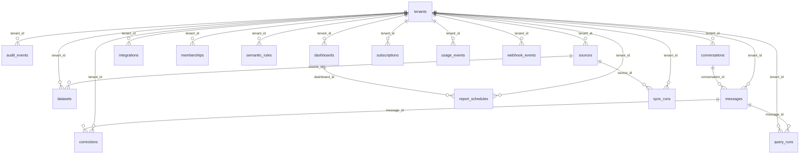

# Modelagem do domínio

Todos os modelos têm UUID string como chave primária (gerado no servidor) e
created_at UTC obrigatório. Entidades com tenant_id pertencem à organização; exclusão
física em cascata é restrita à rotina de retenção/exclusão, nunca executada implicitamente
por uma tela de cadastro. Secrets são referências, não tokens em JSON público.

O plano de controle usa tabelas compartilhadas; schemas t_<uuid> receberão dados importados.
O boilerplate declara FKs e índices. Checks avançados de negócio e RLS são entregues nos
tickets BE-001/003; os estados abaixo são contratos a impor antes de produção.

## Diagrama ER

## tenants

| Campo | Tipo | Obrigatório | Default | Constraints |
|---|---|---|---|---|
| name | VARCHAR(120) | sim | — | — |
| schema_name | VARCHAR(40) | sim | — | UNIQUE |
| id | VARCHAR(36) | sim | gerado no servidor | PK |
| created_at | DATETIME | sim | gerado no servidor | — |

**Índices e unicidades:**

- Único: schema_name; impede duplicação de identidade de negócio.

**Regras:** name não vazio; schema_name gerado de UUID e imutável. Provisionamento atômico com membership owner.

## audit_events

| Campo | Tipo | Obrigatório | Default | Constraints |
|---|---|---|---|---|
| actor_id | VARCHAR(36) | sim | — | — |
| action | VARCHAR(80) | sim | — | — |
| resource_id | VARCHAR(36) | sim | — | — |
| details | JSON | sim | gerado no servidor | — |
| tenant_id | VARCHAR(36) | sim | — | FK tenants.id, ON DELETE CASCADE |
| id | VARCHAR(36) | sim | gerado no servidor | PK |
| created_at | DATETIME | sim | gerado no servidor | — |

**Índices e unicidades:**

- `ix_audit_events_tenant_id` em tenant_id: filtro/ordenação frequente.

**Regras:** imutável; actor/action/resource; detalhes mínimos redigidos, com política de retenção.

## conversations

| Campo | Tipo | Obrigatório | Default | Constraints |
|---|---|---|---|---|
| title | VARCHAR(180) | sim | — | — |
| user_id | VARCHAR(36) | sim | — | — |
| tenant_id | VARCHAR(36) | sim | — | FK tenants.id, ON DELETE CASCADE |
| id | VARCHAR(36) | sim | gerado no servidor | PK |
| created_at | DATETIME | sim | gerado no servidor | — |

**Índices e unicidades:**

- `ix_conversations_tenant_id` em tenant_id: filtro/ordenação frequente.

**Regras:** user_id define dono quando conversa privada; todo acesso continua exigindo tenant.

## dashboards

| Campo | Tipo | Obrigatório | Default | Constraints |
|---|---|---|---|---|
| name | VARCHAR(120) | sim | — | — |
| spec | JSON | sim | gerado no servidor | — |
| tenant_id | VARCHAR(36) | sim | — | FK tenants.id, ON DELETE CASCADE |
| id | VARCHAR(36) | sim | gerado no servidor | PK |
| created_at | DATETIME | sim | gerado no servidor | — |

**Índices e unicidades:**

- `ix_dashboards_tenant_id` em tenant_id: filtro/ordenação frequente.

**Regras:** spec restrita a tipos e query_run_id autorizado; não contém JS/HTML executável. Revalidar query e versão ao atualizar.

## integrations

| Campo | Tipo | Obrigatório | Default | Constraints |
|---|---|---|---|---|
| provider | VARCHAR(30) | sim | — | — |
| external_id | VARCHAR(160) | sim | — | — |
| secret_ref | VARCHAR(250) | sim | — | — |
| tenant_id | VARCHAR(36) | sim | — | FK tenants.id, ON DELETE CASCADE |
| id | VARCHAR(36) | sim | gerado no servidor | PK |
| created_at | DATETIME | sim | gerado no servidor | — |

**Índices e unicidades:**

- `ix_integrations_tenant_id` em tenant_id: filtro/ordenação frequente.
- Único: provider, external_id; impede duplicação de identidade de negócio.

**Regras:** provider em google/resend/asaas/whatsapp; external_id único por provider. secret_ref acessível apenas ao backend.

## memberships

| Campo | Tipo | Obrigatório | Default | Constraints |
|---|---|---|---|---|
| tenant_id | VARCHAR(36) | sim | — | FK tenants.id, ON DELETE CASCADE |
| user_id | VARCHAR(36) | sim | — | — |
| role | VARCHAR(16) | sim | viewer | — |
| id | VARCHAR(36) | sim | gerado no servidor | PK |
| created_at | DATETIME | sim | gerado no servidor | — |

**Índices e unicidades:**

- `ix_memberships_user_id` em user_id: filtro/ordenação frequente.
- Único: tenant_id, user_id; impede duplicação de identidade de negócio.

**Regras:** role em owner/admin/analyst/viewer; não remover último owner. user_id referencia sub do Supabase sem copiar senha.

## semantic_rules

| Campo | Tipo | Obrigatório | Default | Constraints |
|---|---|---|---|---|
| text | TEXT | sim | — | — |
| status | VARCHAR(24) | sim | pending | — |
| version | INTEGER | sim | 1 | — |
| approved_by | VARCHAR(36) | não | — | — |
| tenant_id | VARCHAR(36) | sim | — | FK tenants.id, ON DELETE CASCADE |
| id | VARCHAR(36) | sim | gerado no servidor | PK |
| created_at | DATETIME | sim | gerado no servidor | — |

**Índices e unicidades:**

- `ix_semantic_rules_tenant_id` em tenant_id: filtro/ordenação frequente.

**Regras:** pending/approved/retired. approved_by obrigatório ao aprovar; revisão incrementa versão e invalida cache.

## sources

| Campo | Tipo | Obrigatório | Default | Constraints |
|---|---|---|---|---|
| name | VARCHAR(120) | sim | — | — |
| kind | VARCHAR(24) | sim | — | — |
| status | VARCHAR(24) | sim | draft | — |
| secret_ref | VARCHAR(250) | não | — | — |
| config | JSON | sim | gerado no servidor | — |
| tenant_id | VARCHAR(36) | sim | — | FK tenants.id, ON DELETE CASCADE |
| id | VARCHAR(36) | sim | gerado no servidor | PK |
| created_at | DATETIME | sim | gerado no servidor | — |

**Índices e unicidades:**

- `ix_sources_tenant_id` em tenant_id: filtro/ordenação frequente.
- Único: tenant_id, name; impede duplicação de identidade de negócio.

**Regras:** kind em csv/xlsx/google_sheets/postgres/mysql; status draft/ready/syncing/failed/revoked. Apenas fontes prontas entram no catálogo.

## subscriptions

| Campo | Tipo | Obrigatório | Default | Constraints |
|---|---|---|---|---|
| provider_id | VARCHAR(160) | não | — | UNIQUE |
| plan | VARCHAR(30) | sim | pilot | — |
| status | VARCHAR(24) | sim | trial | — |
| monthly_limit | INTEGER | sim | 1000 | — |
| tenant_id | VARCHAR(36) | sim | — | FK tenants.id, ON DELETE CASCADE |
| id | VARCHAR(36) | sim | gerado no servidor | PK |
| created_at | DATETIME | sim | gerado no servidor | — |

**Índices e unicidades:**

- `ix_subscriptions_tenant_id` em tenant_id: filtro/ordenação frequente.
- Único: tenant_id; impede duplicação de identidade de negócio.
- Único: provider_id; impede duplicação de identidade de negócio.

**Regras:** um registro por tenant; monthly_limit positivo; trial/active/past_due/canceled. Estado autoritativo reconciliado com billing.

## usage_events

| Campo | Tipo | Obrigatório | Default | Constraints |
|---|---|---|---|---|
| kind | VARCHAR(30) | sim | — | — |
| units | INTEGER | sim | 1 | — |
| tenant_id | VARCHAR(36) | sim | — | FK tenants.id, ON DELETE CASCADE |
| id | VARCHAR(36) | sim | gerado no servidor | PK |
| created_at | DATETIME | sim | gerado no servidor | — |

**Índices e unicidades:**

- `ix_usage_events_tenant_id` em tenant_id: filtro/ordenação frequente.
- `ix_usage_tenant_date` em tenant_id, created_at: filtro/ordenação frequente.

**Regras:** units >=0; evento imutável; agregado por tenant/período para orçamento e faturamento.

## webhook_events

| Campo | Tipo | Obrigatório | Default | Constraints |
|---|---|---|---|---|
| provider | VARCHAR(30) | sim | — | — |
| external_id | VARCHAR(160) | sim | — | — |
| status | VARCHAR(24) | sim | received | — |
| tenant_id | VARCHAR(36) | sim | — | FK tenants.id, ON DELETE CASCADE |
| id | VARCHAR(36) | sim | gerado no servidor | PK |
| created_at | DATETIME | sim | gerado no servidor | — |

**Índices e unicidades:**

- `ix_webhook_events_tenant_id` em tenant_id: filtro/ordenação frequente.
- Único: provider, external_id; impede duplicação de identidade de negócio.

**Regras:** received/processed/failed; unique provider+external_id impede replay lógico; assinatura antes de persistir.

## datasets

| Campo | Tipo | Obrigatório | Default | Constraints |
|---|---|---|---|---|
| source_id | VARCHAR(36) | sim | — | FK sources.id, ON DELETE CASCADE |
| table_name | VARCHAR(63) | sim | — | — |
| version | INTEGER | sim | 1 | — |
| catalog | JSON | sim | gerado no servidor | — |
| tenant_id | VARCHAR(36) | sim | — | FK tenants.id, ON DELETE CASCADE |
| id | VARCHAR(36) | sim | gerado no servidor | PK |
| created_at | DATETIME | sim | gerado no servidor | — |

**Índices e unicidades:**

- `ix_datasets_tenant_id` em tenant_id: filtro/ordenação frequente.
- Único: source_id, table_name; impede duplicação de identidade de negócio.

**Regras:** version positiva e incrementada somente na publicação; catalog descreve colunas, tipos, chaves e proveniência.

## messages

| Campo | Tipo | Obrigatório | Default | Constraints |
|---|---|---|---|---|
| conversation_id | VARCHAR(36) | sim | — | FK conversations.id, ON DELETE CASCADE |
| role | VARCHAR(16) | sim | — | — |
| content | TEXT | sim | — | — |
| evidence | JSON | sim | gerado no servidor | — |
| tenant_id | VARCHAR(36) | sim | — | FK tenants.id, ON DELETE CASCADE |
| id | VARCHAR(36) | sim | gerado no servidor | PK |
| created_at | DATETIME | sim | gerado no servidor | — |

**Índices e unicidades:**

- `ix_messages_conversation_created` em conversation_id, created_at: filtro/ordenação frequente.
- `ix_messages_tenant_id` em tenant_id: filtro/ordenação frequente.

**Regras:** role user/assistant; evidence contém IDs/versões/estado, nunca senha. conversation e message têm mesmo tenant.

## report_schedules

| Campo | Tipo | Obrigatório | Default | Constraints |
|---|---|---|---|---|
| dashboard_id | VARCHAR(36) | sim | — | FK dashboards.id, ON DELETE CASCADE |
| timezone | VARCHAR(80) | sim | America/Sao_Paulo | — |
| cron | VARCHAR(100) | sim | — | — |
| enabled | BOOLEAN | sim | False | — |
| tenant_id | VARCHAR(36) | sim | — | FK tenants.id, ON DELETE CASCADE |
| id | VARCHAR(36) | sim | gerado no servidor | PK |
| created_at | DATETIME | sim | gerado no servidor | — |

**Índices e unicidades:**

- `ix_report_schedules_tenant_id` em tenant_id: filtro/ordenação frequente.

**Regras:** cron válido e timezone IANA; disabled por padrão. dashboard e destinatários pertencem ao tenant.

## sync_runs

| Campo | Tipo | Obrigatório | Default | Constraints |
|---|---|---|---|---|
| source_id | VARCHAR(36) | sim | — | FK sources.id, ON DELETE CASCADE |
| idempotency_key | VARCHAR(100) | sim | — | — |
| status | VARCHAR(24) | sim | pending | — |
| summary | JSON | sim | gerado no servidor | — |
| tenant_id | VARCHAR(36) | sim | — | FK tenants.id, ON DELETE CASCADE |
| id | VARCHAR(36) | sim | gerado no servidor | PK |
| created_at | DATETIME | sim | gerado no servidor | — |

**Índices e unicidades:**

- `ix_sync_runs_tenant_id` em tenant_id: filtro/ordenação frequente.
- Único: tenant_id, source_id, idempotency_key; impede duplicação de identidade de negócio.

**Regras:** pending/running/staged/validated/published/failed. Mesmo idempotency_key não pode publicar duas vezes.

## corrections

| Campo | Tipo | Obrigatório | Default | Constraints |
|---|---|---|---|---|
| message_id | VARCHAR(36) | sim | — | FK messages.id, ON DELETE CASCADE |
| reason | TEXT | sim | — | — |
| proposed_rule | TEXT | sim | — | — |
| status | VARCHAR(24) | sim | pending | — |
| tenant_id | VARCHAR(36) | sim | — | FK tenants.id, ON DELETE CASCADE |
| id | VARCHAR(36) | sim | gerado no servidor | PK |
| created_at | DATETIME | sim | gerado no servidor | — |

**Índices e unicidades:**

- `ix_corrections_tenant_id` em tenant_id: filtro/ordenação frequente.

**Regras:** pending/approved/rejected; regra proposta não entra no retrieval ativo automaticamente. message pertence ao tenant.

## query_runs

| Campo | Tipo | Obrigatório | Default | Constraints |
|---|---|---|---|---|
| message_id | VARCHAR(36) | sim | — | FK messages.id, ON DELETE CASCADE |
| sql | TEXT | não | — | — |
| status | VARCHAR(24) | sim | — | — |
| provenance | JSON | sim | gerado no servidor | — |
| tenant_id | VARCHAR(36) | sim | — | FK tenants.id, ON DELETE CASCADE |
| id | VARCHAR(36) | sim | gerado no servidor | PK |
| created_at | DATETIME | sim | gerado no servidor | — |

**Índices e unicidades:**

- `ix_query_runs_tenant_id` em tenant_id: filtro/ordenação frequente.

**Regras:** status validated/running/succeeded/rejected/failed; SQL só do pipeline validado. message_id tem mesmo tenant.

## Constraints a ampliar nos próximos tickets

Adicionar CHECKs para enums/limites e FKs compostas (tenant_id, resource_id) entre entidades
dependentes no BE-003; hoje o serviço verifica relações expostas, mas o banco não impede
todos os cruzamentos por escrita direta. Provisionamento, RLS e role restrita são gate do piloto.
Embedding de exemplos aprovados será tabela tenant-scoped com vector(d) compatível com
modelo escolhido no BE-010. A extensão pgvector já é habilitada no PostgreSQL; não existe
dimensão fictícia ou embedding gerado nesta entrega.
